# Reloading Tracker 2.16.0: User Guide

Reloading Tracker is your complete bench-to-range companion. It starts as a production log: define your loads, record every pressing session with a unique lot number, and print a label for every box on your shelf.

It grows with you from there. Keep one inventory of your components. Work up new loads with a charge ladder and let the range results pick the best charge. Keep a list of your firearms so every range session is tied to the right gun. Log each range trip, star your best sessions, and see how many rounds are left in each lot. Upload target photos, mark the impacts, and get group statistics right away: extreme spread, mean radius, CEP50, and windage and elevation offset. Colour-coded groups let you compare several loads on the same target.

If you also care about costs, the app covers that too. Compare your reloads with factory ammunition, track how close you are to paying off your equipment, and see a side-by-side cost breakdown for any mix of loads. This part is optional; plenty of reloaders just want the log and the data.

> **DOWNLOAD:** A desktop version is available from the releases page: [**latest version**](https://github.com/fmalpartida/reloading-cost-calculator/releases/tag/v2.16.0). All previous versions are available [here](https://github.com/fmalpartida/reloading-cost-calculator/releases).

Want to try it out first?

> **ONLINE VERSION:** A working web version of the app is live at [**Try it out**](https://fmalpartida.github.io/reloading-cost-calculator). No install needed: open it in your browser and start logging.

> **YOUR DATA IS PORTABLE.** The web and desktop versions use the same export file, so you can move between them without losing your loads, journal, range log, firearms, or targets. See [Import & Export](#12-import--export). *The web version stores nothing online; your data stays in your browser.*

Enjoying Reloading Tracker? New features, bug fixes, and late-night coding sessions all run on coffee. If the app has saved you time at the bench, or saved you from a spreadsheet, consider buying me one!

## ⚠️ IMPORTANT SAFETY DISCLAIMER ⚠️

> **WARNING: DO NOT USE THE LOAD DATA IN THIS GUIDE.**
>
> Any load recipe shown in this guide (powder charges, bullet weights, COALs, or any other reloading data) is for **illustration purposes only**. These values are **not safe for use** in actual reloading.
>
> **Always build your loads from reliable, published reloading data** from reputable sources such as powder manufacturers, bullet manufacturers, or established reloading manuals. Never copy load data from screenshots, examples, or guides like this one.
>
> Improper reloading can result in serious injury, death, or property damage.

---

## Table of Contents

1. [Overview](#1-overview)
   - [Recommended Workflow](#recommended-workflow)
   - [Tabs at a Glance](#tabs-at-a-glance)
2. [My Ammo](#2-my-ammo)
   - [Adding a Reload Entry](#21-adding-a-reload-entry)
   - [Adding a Factory Ammo Entry](#22-adding-a-factory-ammo-entry)
   - [Managing Entries](#23-managing-entries)
   - [Load Status](#load-status)
   - [Default Taxes & Fees](#24-default-taxes--fees)
   - [Charge Workup (Load Development)](#25-charge-workup-load-development)
   - [Shotshells](#26-shotshells)
3. [My Components](#3-my-components)
   - [Adding a Component](#31-adding-a-component)
   - [Managing Components](#32-managing-components)
   - [Linking Inventory to Loads](#33-linking-inventory-to-loads)
4. [Firearms Registry](#4-firearms-registry)
   - [Adding a Firearm Profile](#41-adding-a-firearm-profile)
   - [Managing Firearm Profiles](#42-managing-firearm-profiles)
   - [Filtering and Searching](#43-filtering-and-searching)
   - [Card and Table Views](#44-card-and-table-views)
   - [Firearm Datasheet](#45-firearm-datasheet)
5. [Reloading Journal](#5-reloading-journal)
   - [Logging a Session](#51-logging-a-session)
   - [Managing Journal Entries](#52-managing-journal-entries)
   - [Printing a Lot Label](#53-printing-a-lot-label)
   - [Journal Statistics](#54-journal-statistics)
6. [Range Log](#6-range-log)
   - [Logging a Range Session](#61-logging-a-range-session)
   - [Managing Range Sessions](#62-managing-range-sessions)
   - [Starring Sessions](#63-starring-sessions)
   - [Range Log Statistics](#64-range-log-statistics)
7. [Targets](#7-targets)
   - [Target Analysis](#71-target-analysis-sub-tab)
     - [Creating a Target Record](#711-creating-a-target-record)
     - [Uploading and Calibrating the Image](#712-uploading-and-calibrating-the-image)
     - [Marking Impacts and Point of Aim](#713-marking-impacts-and-point-of-aim)
     - [Statistics Panel](#714-statistics-panel)
     - [Working with Groups](#715-working-with-groups)
     - [Aggregate View](#716-aggregate-view)
     - [Linking to a Range Session](#717-linking-to-a-range-session)
     - [Printing a Target](#718-printing-a-target)
     - [Aggregating Groups Across Targets](#719-aggregating-groups-across-targets)
   - [Compare](#72-compare-sub-tab)
   - [Target Generator](#73-target-generator-sub-tab)
     - [Creating a Target Sheet](#731-creating-a-target-sheet)
     - [Configuring Rings](#732-configuring-rings)
     - [Layout, Page Size, and Grid](#733-layout-page-size-and-grid)
     - [Annotations](#734-annotations)
     - [Managing Target Sheets](#735-managing-target-sheets)
     - [Printing a Target Sheet](#736-printing-a-target-sheet)
8. [Cost Analysis (Break-Even)](#8-cost-analysis-break-even)
   - [Load Selection](#81-load-selection)
   - [Equipment Costs](#82-equipment-costs)
   - [Reading the Chart & Stats](#83-reading-the-chart--stats)
9. [Cost Comparison](#9-cost-comparison)
10. [Guided Tour](#10-guided-tour)
11. [Settings & About](#11-settings--about)
12. [Import & Export](#12-import--export)
13. [Tips & Notes](#13-tips--notes)

---

## 1. Overview

### Recommended Workflow

Reloading Tracker follows the way reloading actually works. Steps 1 to 4 are the core workflow for any reloader. Step 5 adds cost and break-even tracking for those who want it.

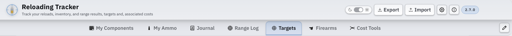

**Step 1: Define your loads**

Before you can log sessions, the application needs to know what you are reloading. You have two ways to add a load:

- **Direct entry in My Ammo.** Open the Editor tab and fill in the load details. This is the fastest way to get started.
- **Build a component library first (recommended).** Go to **My Components** and add your powders, primers, bullets, and brass. When you create a load, pick each component from that list instead of typing it in. When a price changes, you update it in one place and every load that uses it updates too.

> **If you plan to use the cost features**, enter what you actually paid, including shipping if it changes the per-unit cost much. Update the price whenever you buy a new batch.

If you use Cost Analysis or Cost Comparison, also add at least one **factory ammo** entry with its box price, taxes, and fees. It's the baseline your reloads are compared against.

**Step 2a (optional): Work up a new load**

If you are developing a new load, set its status to **In Development** and set up a **Charge Ladder** in the Editor. Then open the **Charge Workup** panel (ladder icon on the load card or table row). From there you plan charges, log pressing sessions, record velocity and accuracy at the range, and promote the winning charge to your load. See [Charge Workup](#25-charge-workup-load-development) for details.

**Step 2b: Log your pressing sessions in the Journal**

Every time you sit down at the press, open the **Journal** tab and add an entry: pick the load, then enter the date and the number of rounds you made. The app assigns the next lot number for you.

Over time these entries build a production history: what you made, when, and how much. That record is useful on its own, and it also feeds Cost Analysis if you track break-even.

**Step 3: Print lot labels**

After logging a session, click **Print** on the journal entry. The label dialog opens with the lot number and quantity filled in. Check the label (load name, caliber, components, COAL) and print it. Stick it on the ammo box before it goes on the shelf, so every box traces back to a lot in the journal. You can also print an extra label for your paper log book.

**Step 4: Take it to the range and log the session**

After a range trip, open the **Range Log** tab and add a session. Choose the firearm, the date, the distance, and the lots you shot. You can log several lots in one session, each with its own round count, charge weight, COAL, and notes.

The firearm list comes from the **Firearms** tab, so you don't retype names and your results stay tied to the same gun. If you type a firearm that isn't in the list yet, it's added for you as a basic profile you can fill in later.

Over time the Range Log becomes a searchable record that links each session to the lots and recipes you shot. Star sessions with great results, then use the starred filter to find them when you're deciding what to reload next.

> **The bench-to-range loop.** The Journal tells you what you made and when. The Range Log tells you how each lot performed. Together they show which loads are worth pressing again and which need more work.

**Step 4b (optional): Analyse your target**

After a range session, open the **Targets** tab. The tab has three sub-tabs:

- **Target Analysis**: create a target record, upload a photo, set the scale using a known distance, and mark each impact. Group statistics (extreme spread, mean radius, CEP50, offset from your point of aim, and more) update as you place shots. If one target holds several loads or charges, put the impacts in colour-coded groups to compare them. Link the target to its range session to jump between the two.
- **Compare**: shows every target linked to a range session in one table. Filter by load to see which charge gave the best group and the most consistent velocity.
- **Target Generator**: design and print your own target sheets. Set the scoring rings, colours, and sizes, put several targets on a page, add a grid, and label each target with the load and firearm you plan to use.

**Step 5 (optional): Review your costs and track break-even**

Once you have journal entries, open **Cost Analysis** and switch to **Rounds** mode. Your journal rounds are added to your reloads automatically. The chart shows how close you are to break-even, and the stats show how many rounds are left until your equipment pays for itself and how much you've saved so far.

Use **Cost Comparison** any time to see which of your loads is cheapest, or whether a factory box would have cost less than your reload.

---

The more consistently you log, the more the app gives back. After a year you'll have a full production and performance record of every lot you've pressed and, if you use the cost features, a real picture of what reloading saves you.

---

### Tabs at a Glance

The app has seven main tabs in the bar at the top:

| Tab | Purpose |
|-----|---------|
| **My Ammo** | Library of all your ammo entries: reloads and factory |
| **My Components** | Global catalog of reloading components: powders, primers, bullets, and brass, plus hulls, wads, shot, and slugs for shotshells |
| **Firearms** | Registry of your firearm profiles: type, caliber, action, barrel, and twist data, plus a photo, serial number, price, and mounted optic details |
| **Journal** | Log pressing sessions with auto-incrementing lot numbers, dates, quantities, and notes |
| **Range Log** | Record range sessions: firearm, distance, lots fired, round counts, performance notes |
| **Targets** | Three sub-tabs. **Target Analysis**: upload target photos, mark impacts, and measure groups. **Compare**: one table of all targets linked to range sessions, filterable by load. **Target Generator**: design and print target sheets. |
| **Cost Tools** | Two sub-tabs. **Cost Analysis**: when reloading pays off after your equipment costs. **Cost Comparison**: side-by-side costs for the loads you pick. |

An **Editor** tab appears automatically whenever you are adding or editing an ammo entry.

The top bar also has **Tour**, **About**, and **Settings**. Tour walks you through the app. About shows the version, author, and license. Settings covers display preferences such as theme, currency symbol, and cost precision.

**Customizing the tab bar**

A pencil-icon **Customize Tabs** button sits to the right of the tabs. Click it to open a dialog where you can:

- **Reorder tabs** by dragging them into any position using the grip handle, or with the up and down arrows on each row
- **Hide tabs** you do not use by unchecking them - at least one tab must always stay visible
- **Reset to Default** to restore the original order and visibility at any time

Your tab layout is saved automatically.

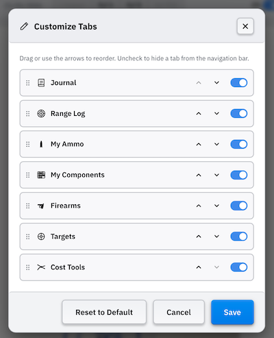

---

## 2. My Ammo

The **My Ammo** tab is your ammunition library. Reloads come first, then factory ammo, each sorted from cheapest to most expensive. Each group's header has a **+** button to add an entry of that type. Inside each group, entries are split into **Handgun**, **Rifle**, and **Shotgun**, with anything else under **Uncategorized**.

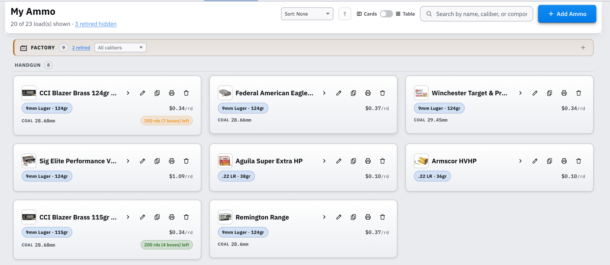

### 2.1 Adding a Reload Entry

Click **Add Ammo** in the top-right corner, or the **+** button in the **Reloads** section header. The Editor opens with **Reload** already selected. Fill in these sections:

**Ammo Information**
- **Name**: identifies the cartridge. Required.
- **Load Type**: Reload or Factory.
- **Ammo Class**: Metallic Cartridge or Shotshell. Picking Shotshell switches the form to shotshell components, see [Shotshells](#26-shotshells).
- **Category**: Handgun, Rifle, or Shotgun. Groups the entry in My Ammo and narrows the caliber list to that category. It fills in from the caliber until you pick one yourself.
- **Status**: the development state of the load. See [Load Status](#load-status) below.
- **Caliber**: the cartridge designation (e.g. *9mm Luger*, *.308 Win*). This is added when defining the bullet.
- **COAL**: cartridge overall length for this load. Printed on the lot label.
- **Notes**: optional free-text field for dates or any other reference.

**Powder**
- Powder name, measurement system (Imperial grains or Metric grams), price per lb/kg, and charge weight per round.

**Primers**
- Primer name, price, and the quantity that price covers (default 100).

**Bullets / Projectiles**
- Bullet description, weight, diameter, caliber, price, and quantity (default 100).

**Brass / Cases**
- Brass description, price, quantity, and how many times each case will be reloaded before replacement. The cost per round is divided by this reuse count.

**Stock**
- Rounds in hand come from the Journal. Each lot you press for this load adds rounds, and rounds you log against those lots in the Range Log are taken off. Archived lots don't count. The only field here is **Alert Below (rounds)**: when rounds in hand fall to or below this number, the card's stock pill turns orange and the table shows a **Low** badge.

**Sales Tax**
- The sales tax percentage applied to your total component cost.

A **Live Preview** panel on the right updates as you type. It shows the cost per round and totals for 50, 100, and 1000 rounds.

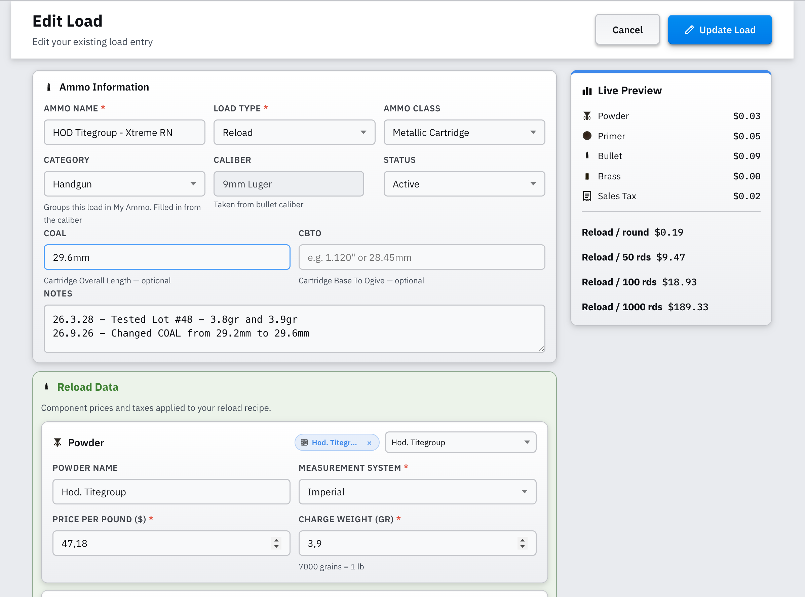

Click **Save Load** or **Update Load** when done. The entry shows up in My Ammo right away and is available in Cost Comparison and Cost Analysis.

### 2.2 Adding a Factory Ammo Entry

Click **Add Ammo** or the **+** button in the **Factory** section header. The Editor opens with **Factory Ammo** pre-selected. The form shows:

**Stock** *(optional)*
- Tracks how many rounds of this ammo you have left. Enter the number of boxes you bought in **Add Boxes** and click **Add** (or just save). Boxes add up in the **Lifetime total** shown below the field. To fix a mistake, such as adding a box twice, enter a negative number and click **Add**. The total never goes below zero.
- **Alert Below (boxes)**: optional threshold. When the rounds remaining fall to or below this many boxes, the card's stock pill turns orange and a **Low** badge appears in the table.
- Rounds remaining = *Lifetime total × Rounds per Box*, minus every round of this ammo logged in the Range Log. That includes sessions logged before you started tracking stock.
- While stock is tracked, the **Live Preview** shows the boxes and rounds in hand, with a **Low** badge when you're below your alert. It updates as you type, before you save.
- To skip stock tracking for this ammo, leave **Add Boxes** empty. Stock stays hidden until you add at least one box.

**Base Factory Price**
- Price per box and rounds per box.

**Factory Taxes**
- Sales tax (%), State excise tax (%).

**Additional Fixed Cost**
- A flat fee spread over a number of rounds, useful for background check fees (e.g. $25 over 500 rounds = $0.05/rd extra) if applicable in your State.

**Photo** *(optional)*
- Upload a photo of the ammo box. iPhone HEIC photos are converted automatically. The photo is resized for storage and shown as a thumbnail on the card and in table view (see [2.3](#23-managing-ammo-entries)). Click **Remove** to clear it.

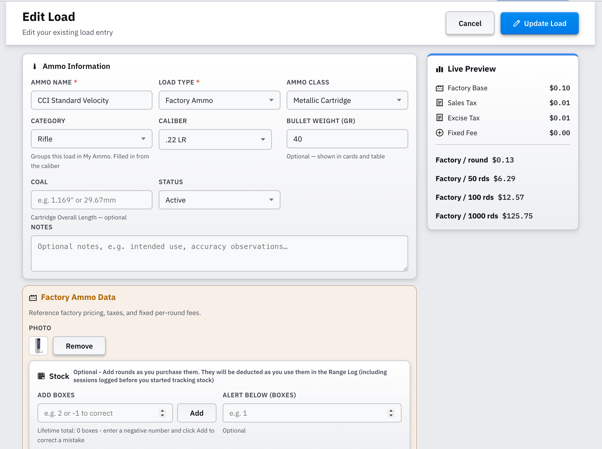

### 2.3 Managing Ammo Entries

Each ammo card has four action buttons in its top-right corner:

| Button | Action |
|--------|--------|
| ✏️ Edit | Opens the entry in the Editor tab |
| ⧉ Duplicate | Creates a copy of the entry (useful for variants of the same load) |
| 🖨 Print | Opens the label print dialog for this load, without a pre-filled lot number or quantity |
| 🗑 Delete | Permanently removes the entry |

Click the **▸ / ▾** chevron on the left of the action buttons to expand a card and see the full component cost breakdown.

Use the **Search** box to filter cards by name, caliber, type, or component name.

When the **Reloads** or **Factory** section holds more than one caliber, a **caliber filter** appears in its header. Each section filters on its own: you can show only your 6.5 Creedmoor reloads and still see all factory ammo. The filter works with search and the retired toggle, and the count at the top follows it. If nothing is left to show, click **Clear Filters** to reset the search and both filters.

Switch between **Card** and **Table** view with the toggle next to the search box. Table view is denser and easier to scan when you have many entries.

**Stock display**

Ammo that tracks stock shows a **stock pill** on the card and a **Stock** column in table view. Factory ammo shows rounds and boxes left, e.g. *250 rds (5 boxes) left* (see [2.2](#22-adding-a-factory-ammo-entry)). Reloads show the rounds left in their active Journal lots, e.g. *240 rds left*, which matches the Journal's **Remaining** column (see [2.1](#21-adding-a-reload-entry)). Ammo with no stock tracked shows nothing.

On the card, the pill sits at the right end of the card. Its color shows where you stand: **green** while you have stock, **orange** at or below your **Alert Below** threshold, and **red** at zero. In table view, a **Low** badge marks the threshold. Hover over the pill to see how the number is worked out.

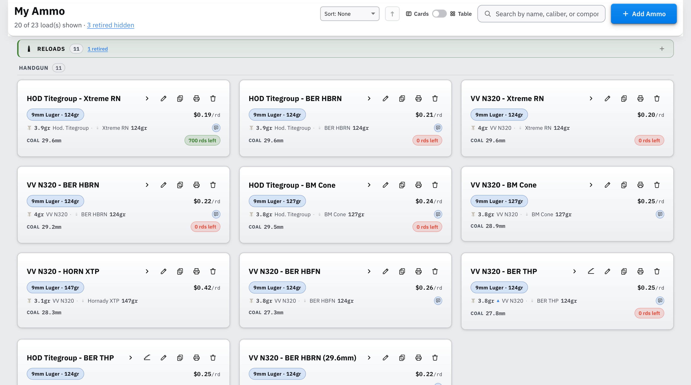

**Photo thumbnails**

Factory ammo with a photo (see [2.2](#22-adding-a-factory-ammo-entry)) shows it as a thumbnail on the card and in the table's Photo column. Hover over the thumbnail to see the ammo's name, caliber, weight, price per box, and cost per round, just like firearm thumbnails (see [4.4](#44-card-and-table-views) and [4.5](#45-firearm-datasheet)).

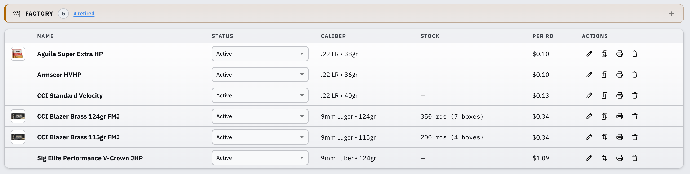

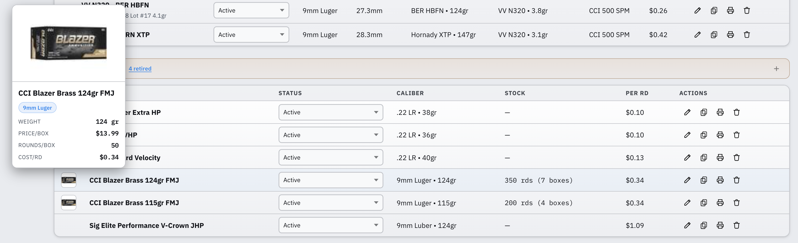

**Photos in the printed Data Sheet**

When you print a load's **Data Sheet**, a factory ammo photo appears at the top. For reloads, the sheet shows a strip of photos of the linked powder, primer, bullet, and brass, when they have one (see [3.3](#33-linking-inventory-to-loads)). Untick **Include photos** at the bottom of the dialog to leave photos out.

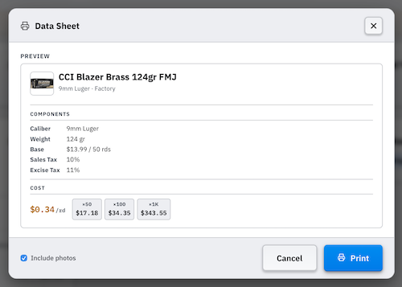

### Load Status

Every ammo entry has a **status** that shows where it is in your development cycle. The status badge appears on each card and in the table's Status column.

| Status | Meaning |
|--------|---------|
| **Draft** | Entered for cost estimation only; not yet range-verified. Cards show a dashed border as a visual reminder. |
| **In Development** | Actively being worked up at the bench or range. Eligible for Journal logging. Unlocks the **Charge Ladder Setup** section in the Editor and the **Charge Workup** panel on the load card. |
| **Active** | Proven load, ready to press. Eligible for Journal logging. |
| **Retired** | Recipe superseded or no longer in use. Hidden from default views but preserved in all history and journal entries. |

**Changing the status**
- In card view: expand the card (▸) and use the **Status** selector at the top of the expanded body.
- In table view: use the **Status** dropdown in the Status column.
- In the Editor: the Status field appears in the Ammo Information section next to the load type.

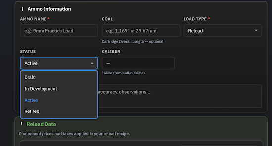 

**Retired loads**
Retired entries are hidden by default. When a section has retired entries, a **"N retired"** link appears in its header bar. Click it to show them; click **"hide retired"** to hide them again.

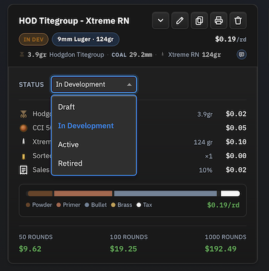

> **Status changes never affect the Journal or Range Log.** A retired load keeps its full history; it's only hidden from the library.

### 2.5 Charge Workup (Load Development)

The **Charge Workup** panel is the built-in load development workflow. Plan a charge ladder, log pressing sessions from the panel, record velocity and group size for each step, and promote the winning charge to your load.

#### Setting up a charge ladder

1. Create or edit a reload entry and set **Status** to **In Development**.
2. A **Charge Ladder Setup** section appears at the bottom of the Editor form. Fill in:

| Field | Description |
|-------|-------------|
| **Min charge** | Starting charge in your ladder (e.g. 38.0 gr) |
| **Max charge** | Upper bound of the ladder (e.g. 42.0 gr) |
| **Step size** | Increment between each step (e.g. 0.5 gr) |
| **Rounds per step** | How many rounds to press at each charge weight (e.g. 20) |

3. Save the load. A **ladder icon (⟑)** now appears on the load card and in the table's action column.

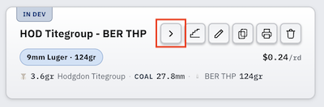

#### The Charge Workup panel

Click the ladder icon to open the **Charge Workup** panel. It contains three main areas:

**Load info bar**

Shows the load name, caliber, and ladder range (e.g. *38.0–42.0 gr · step 0.5 gr · 20 rds/step*). While the load is In Development, a pencil button lets you edit the min, max, step, and rounds right in the bar. A promoted charge shows a green *Promoted: X gr* badge.

**Charge ladder table**

Each ladder step is a row, whether it's still planned or already fired.

| Column | Description |
|--------|-------------|
| ☐ | Checkbox to include this charge in the next batch log |
| **Charge** | The charge weight; a ✓ badge marks the promoted charge |
| **Lot(s)** | Lot number chips for each journal entry at this charge |
| **Qty** | Total rounds pressed at this charge |
| **Sessions** | Number of range sessions that include these lots |
| **Avg fps** | Average muzzle velocity across all sessions for this charge |
| **Avg SD** | Average standard deviation |
| **Best Group** | Best (smallest) group size recorded at this charge |
| **Promote** | Button to promote this charge as the final load (only shown when data exists and the load is In Development) |

Rows with data are lightly tinted. The promoted row is green.

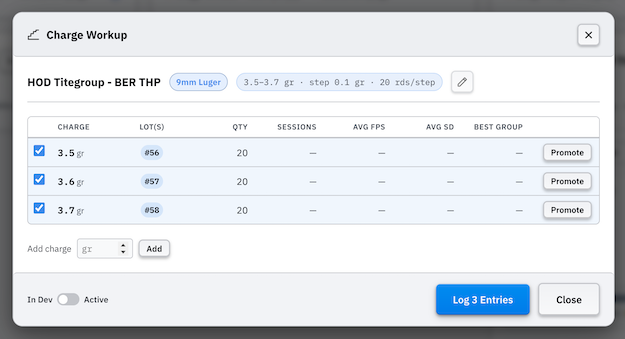

**Logging entries from the workup panel**

All steps are checked by default. Uncheck any you won't press this time, then click **Log N Entries**. The app creates one Journal entry per checked charge, dated today, using the rounds per step and the current lot numbers of the load's linked components.

> You can also add a **one-off charge** outside the ladder: type it in the *Add charge* field below the table and click **Add**. The new row is checked for the next batch log; no journal entry is written yet.

**Performance chart**

Once at least two steps have results in the Range Log, a chart appears below the table:

- **Avg fps** (solid blue line, left axis): average muzzle velocity per charge weight.
- **Lot fps** (blue diamonds): the velocity of each lot, showing the spread when a charge has several lots.
- **Best Group** (dashed amber line, right axis): the best group at each charge. The axis is flipped, so smaller groups sit higher.
- **Lot Group** (amber diamonds): individual lot group sizes.

Hover over a point to see its value, or over a diamond to see which lot it belongs to.

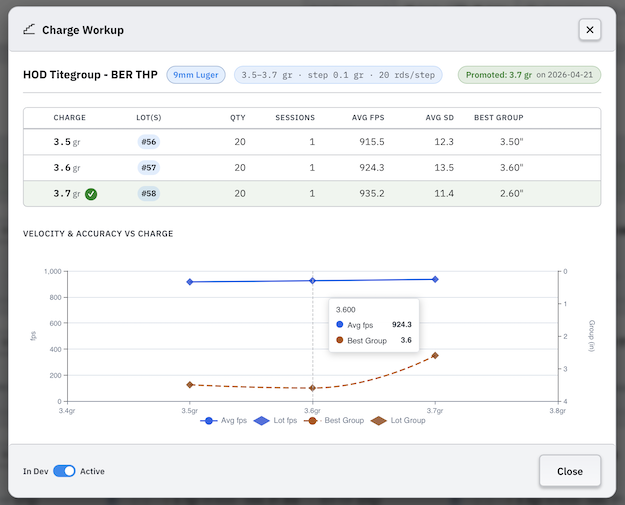

#### Promoting a charge

When the data shows a clear node (a charge with low velocity SD and small groups), click **Promote** on that row and confirm.

Promoting a charge:
- Sets the load's **powder charge** to the promoted value.
- Changes the load's status to **Active**.
- **Stars** all Journal entries for the promoted charge so they are easy to find in the Journal and Range Log.
- **Unstars** any entries that belonged to a previously promoted charge (on re-promotion).

The load is now an active recipe, and the panel switches to a history view of the full development record.

#### Starting a new development cycle

To refine the load further, open the workup panel and use the **In Dev / Active** toggle in the footer. The load goes back to In Development and keeps all its data. You can then change the ladder, add steps, or press more lots.

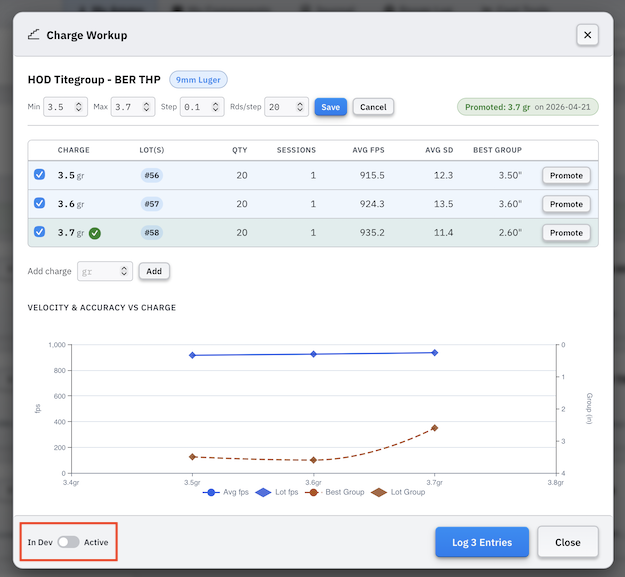

#### Workup data in the printed data sheet

When you print a load's **Data Sheet** from My Ammo, it includes the Charge Workup section if there's development data: the ladder summary, the charge table with the promoted step marked, and the performance chart.

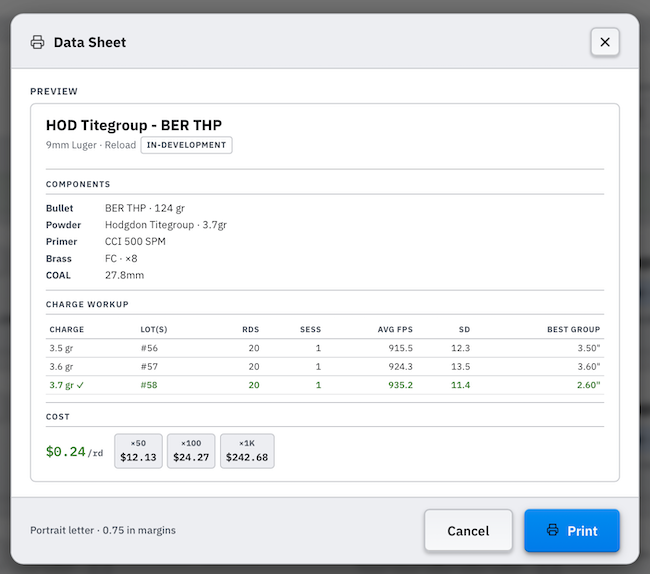

---

### 2.4 Default Taxes & Fees

The **Default Taxes** panel at the top of My Ammo sets the tax values filled in on every new entry.

- **Reload**: sales tax percentage applied to reload component costs.
- **Factory**: sales tax %, excise tax %, fixed fee amount, and the number of rounds that fee covers.

Click **Apply to All** to apply the current defaults to every existing entry.

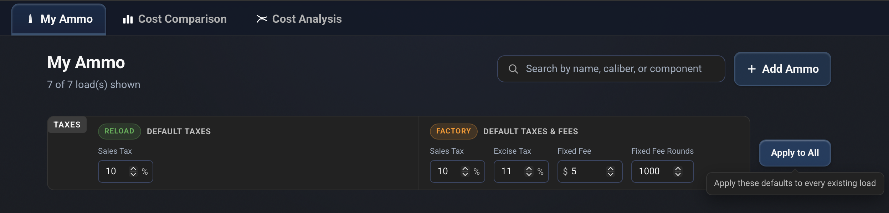

To reset a single entry, use the **Reset to defaults** link in the Editor.

### 2.6 Shotshells

Set **Ammo Class** to **Shotshell** in the Editor for shotgun reloads or factory shells. The **Caliber** field becomes **Gauge** (*12 ga*, *20 ga*, *.410 bore*, and so on). Two fields are added: **Shell Length** (e.g. *2-3/4"* or *70 mm*) and **Projectile** (**Shot**, **Buckshot**, or **Slug**).

**Reloaded shotshells**

The reload form swaps the cartridge sections for shotshell ones:

- **Powder** and **Primers** work exactly as for metallic loads.
- **Shot / Buckshot**: description, material (lead, plated lead, steel, bismuth, tungsten), shot size, pellet count for buckshot, price per lb or kg, and the **Payload** per shell. Payload is in ounces (Imperial) or grams (Metric), matching US and European manuals.
- **Slug**: description, weight in grains, price, and the quantity that price covers.
- **Wads**: description, type (plastic, fiber, custom), price, and the quantity that price covers.
- **Hulls**: replaces Brass / Cases, with the same price, quantity, and times-reloaded fields.
- **Crimp** and **Published Velocity** are optional recipe notes. COAL, CBTO, and the Charge Ladder don't apply to shotshells and are hidden.

Hulls, wads, shot, and slugs can be picked from My Components like any other component (see [3.3](#33-linking-inventory-to-loads)). Hulls, wads, and slugs saved with a gauge only appear for loads of that gauge. The cost breakdown lists the shot, wad, and hull cost per shell.

**Factory shotshells**

Factory entries take the same gauge, shell length, and projectile, plus optional payload, shot material and size, pellet count, slug weight, **Dram Equivalent**, and **Velocity**. Pricing, taxes, and stock work as for any factory ammo (see [2.2](#22-adding-a-factory-ammo-entry)).

> Shotshell recipes are tested as an exact combination of hull, primer, powder, wad, and payload. Don't swap any one of them without published data for the new combination.

---

## 3. My Components

**My Components** is your catalog of reloading components. Define each component once, then pick it from a list when you edit a reload, instead of retyping names and prices. When a price changes, update it here and every linked load updates.

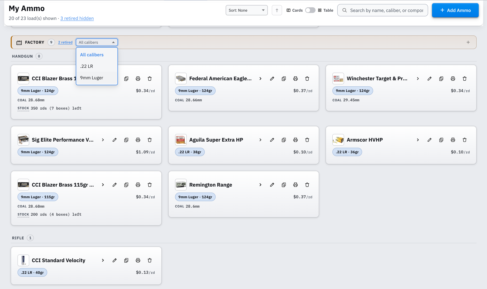

There are eight component types: **Powder**, **Primer**, **Bullet**, and **Brass** for cartridges, plus **Hull**, **Wad**, **Shot**, and **Slug** for shotshells. Each type has its own section, with a colored edge that matches its icon.

**Filter tags** at the top narrow the list to one type. Click a tag to filter; click it again to clear.

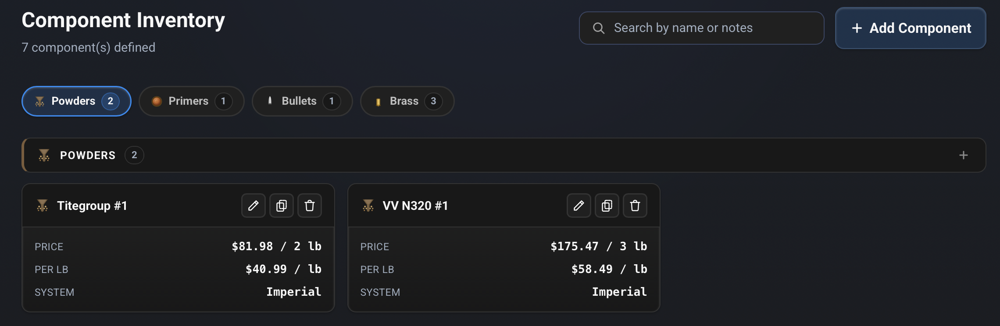

Use the **Search** box to find components by name or notes.

The **Bullets**, **Brass**, and **Hulls** sections get a **caliber filter** in their header (gauge for hulls) once they hold more than one caliber. Each section filters on its own, and its cash total follows the selected caliber.

Like My Ammo, My Components has **Card** and **Table** views.

### 3.1 Adding a Component

Click **Add Component** in the top-right corner, or the small **+** in a section header to start with that type selected.

The form has labeled sections: **Basics** for every type, **Specs** and **Pricing** for bullets, and **Consistency & Fit** and **Annealing** for brass. A **Stock** section comes last for all types.

**Component Type**  
Pick one of the eight types at the top of the form. The type can't be changed after saving; to use a different type, create a new component and delete the old one.

**Name / Description** *(required)*  
A descriptive label, e.g. *Titegroup*, *CCI 500 Small Pistol*, *124gr FMJ RN*, *Mixed once-fired 9mm*.

**Photo** *(optional)*  
Upload a photo of the component. iPhone HEIC photos are converted automatically. The photo is resized for storage and shown as a thumbnail on the card or in the table's Photo column (see [3.2](#32-managing-components)). Click **Remove** to clear it.

**Price** *(required)*  
What you paid. For powder and shot, this is the price per pound (Imperial) or per kilogram (Metric). For everything else, it's the total price for the quantity below.

**Quantity / Weight** *(required)*  
- *Powder, Shot*: the weight the price covers (lb or kg). A 1 lb jug at $28.99 and a 4 lb jug at $89.99 both work out to the right price per pound in a load.
- *Primer, Bullet, Brass, Hull, Wad, Slug*: the number of units the price covers (e.g. 100 primers for $15.99).

**Measurement System** *(powder and shot)*  
Select **Imperial (lb)** or **Metric (kg)**. Loads linked to this component use the same system.

**Shotshell specs** *(optional)*  
- *Hull*: **Gauge**, **Shell Length**, and **Times Reloaded** (required, same as brass).
- *Wad*: **Gauge** and **Wad Type**.
- *Shot*: **Material** and **Shot Size**.
- *Slug*: **Gauge** and **Weight (grains)**.

A hull, wad, or slug with a gauge set only appears in the Editor for loads of that gauge.

**OAL (Overall Length)** *(bullet only, optional)*  
The bullet's overall length, with an **in** / **mm** unit next to it. The unit starts at your Imperial/Metric setting. Switching it converts the number, e.g. *1.169 in* becomes *29.6926 mm*.

**Times Reloaded** *(brass only)*  
How many times each case can be reloaded before you replace it. The brass cost is spread across that many rounds.

**Consistency & Fit** *(brass only, optional)*  
Fields for precision reloading, where case-to-case consistency matters:
- **Case Weight (gr)**: average case weight, useful for checking a lot's consistency or comparing a new batch.
- **Dedicated Firearm**: pick one of your firearms. Use it when brass is fire-formed to one chamber (common with tight-neck or custom chambers) and shouldn't be mixed with brass for another rifle in the same caliber.
- **Shoulder Bump**: the shoulder bump you aim for when full-length sizing this brass, e.g. *0.002*. It has the same **in** / **mm** unit as OAL, and switching converts the number.

**Annealing** *(brass only, optional)*  
- **Annealer**: the machine or method used, e.g. *AMP Press*, *torch*.
- **Annealer Settings**: free text for your process, e.g. *PID 4, 5.5s dwell*.

**Notes**  
Optional free-text field for suppliers or any other reference.

**Stock on hand** *(optional)*  
How much you have now. The unit depends on the type:
- *Powder, Shot*: weight in lb or kg (matching the measurement system you selected)
- *Primer, Bullet, Brass, Hull, Wad, Slug*: individual count

Leave it blank to skip stock tracking. Only components with stock set can be deducted from the Journal.

**Alert below** *(optional)*  
A low-stock threshold, in the same unit as **Stock on hand**. At or below it, the card shows a **Low** badge. It's only a reminder; nothing is blocked.

**Lot #** *(optional)*  
The manufacturer's lot code for the batch you have on hand, e.g. *VG-2291*. New Journal entries record it automatically (see [5.1](#51-logging-a-session)), so update it when you open a new jug of powder or box of primers.

Click **Save**. The card appears in its section right away.

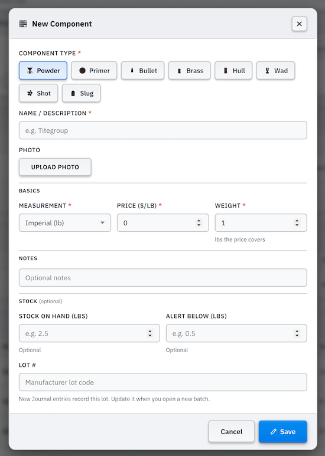

Each component card shows:
- Component name and type icon
- **Price**: the cost per unit (e.g. *$22.50/lb*, or *$0.16 ea* for a primer). The form keeps the price and quantity you entered; the card and table show only the per-unit cost.
- **Stock**: quantity on hand, if you entered one. Powder shows four decimal places; other types show a whole number. A **Low** badge appears at or below the threshold.
- **Lot**: the lot number on hand, shown only when one has been entered.
- Brass **Reloads** count (brass cards only)
- Bullet **caliber**, **diameter**, **weight**, and **OAL** (bullets only)
- Notes (if any)

Brass with **Consistency & Fit** or **Annealing** data shows a **Details** row with an icon for each: a ruler for Consistency & Fit, a flame for Annealing. Hover over an icon to see the details.

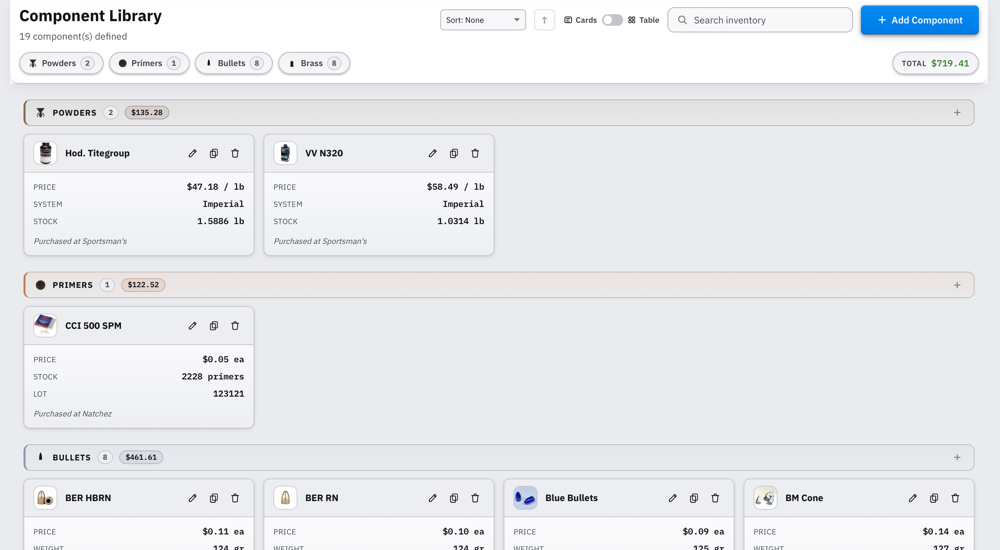

### 3.2 Managing Components

Each component card has four action buttons:

| Button | Action |
|--------|--------|
| ✏️ Edit | Opens the component for editing. The type can't be changed. |
| ⧉ Duplicate | Makes a copy with *(copy)* added to the name, handy when a component comes in several package sizes. A copy of an archived component is active. |
| 📦 Archive | Retires the component without deleting it. Becomes **Restore** on an archived component. See below. |
| 🗑 Delete | Removes the component for good. Loads linked to it keep their last values but are no longer linked. |

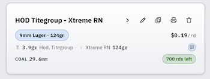

**Archiving components**

When you stop using a component, such as a powder you won't buy again, archive it instead of deleting it. You'll be asked to confirm. Archived components are hidden from the list, left out of the cash totals, and no longer offered in the Editor's inventory lists or the Journal's brass and hull lists. Loads already linked to one stay linked.

When anything is archived, the count under the page title ends with an **"N archived hidden"** link, and each section header shows **"N archived"**. Click either to show archived components, and click **hide archived** to hide them again. Archived cards are dimmed and tagged **ARCHIVED**; table rows get a red edge and an **Archived** tag. Click **Restore** to make one active again.

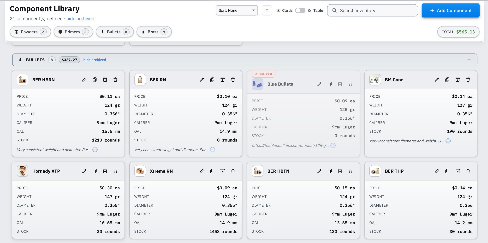

In **Table view**, the **Stock** column shows the quantity on hand with its unit (*primers*, *rounds*, *cases*, *hulls*, *wads*, *slugs*, *lb*, or *kg*), or a dash if not set. A **Low** badge appears at or below the threshold. The **Lot #** column shows the lot number, or a dash.

For brass, an **Info** column holds the same Consistency & Fit and Annealing icons as the cards.

**Sorting**

In **Card view**, the **Sort** dropdown orders components by **A–Z**, **Price**, **Stock**, or **None** (the order you added them). The arrow next to it flips the direction.

In **Table view**, click the **Name**, **Price**, or **Stock** column header instead. Each click cycles through ascending, descending, and no sort. Switching views resets the sort to **None**.

**Photo thumbnails**

Components with a photo (see [3.1](#31-adding-a-component)) show it as a thumbnail in place of the type icon on the card, or in the table's Photo column. Hover over it to see the name, type, price, stock, lot number, and key specs.

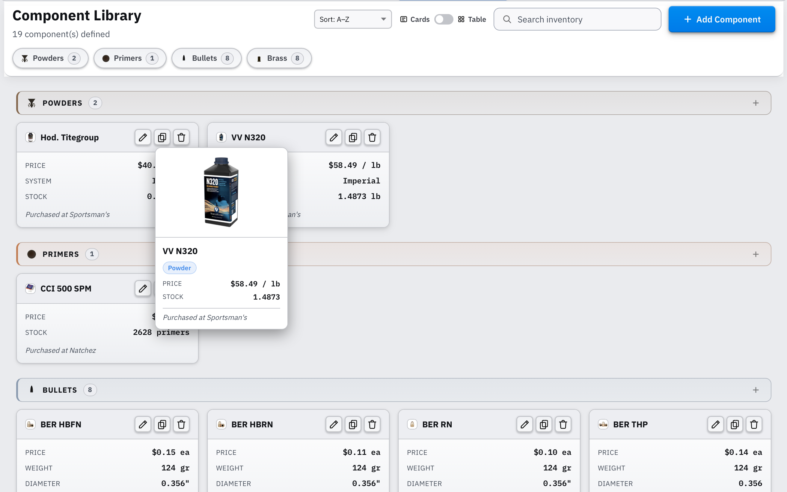

**Cash-in-hand totals**

Each section header shows the total value of that section's stock (quantity × price). A grand total sits at the top of the page. Archived components never count. Search and filter tags don't change the totals, but a section's caliber filter does: pick .308 Win in Bullets and you see only the value of your .308 Win bullets, and the grand total follows.

### 3.3 Linking Inventory to Loads

When you create or edit a reload in the **Editor**, each component section (Powder, Primers, Bullets, Brass, and for shotshells Shot, Slug, Wads, Hulls) has a **Select from inventory** dropdown. Pick an item and its fields fill in, and a **linked badge** appears. Bullets and brass show their caliber and hulls their gauge, so similar names are easy to tell apart.

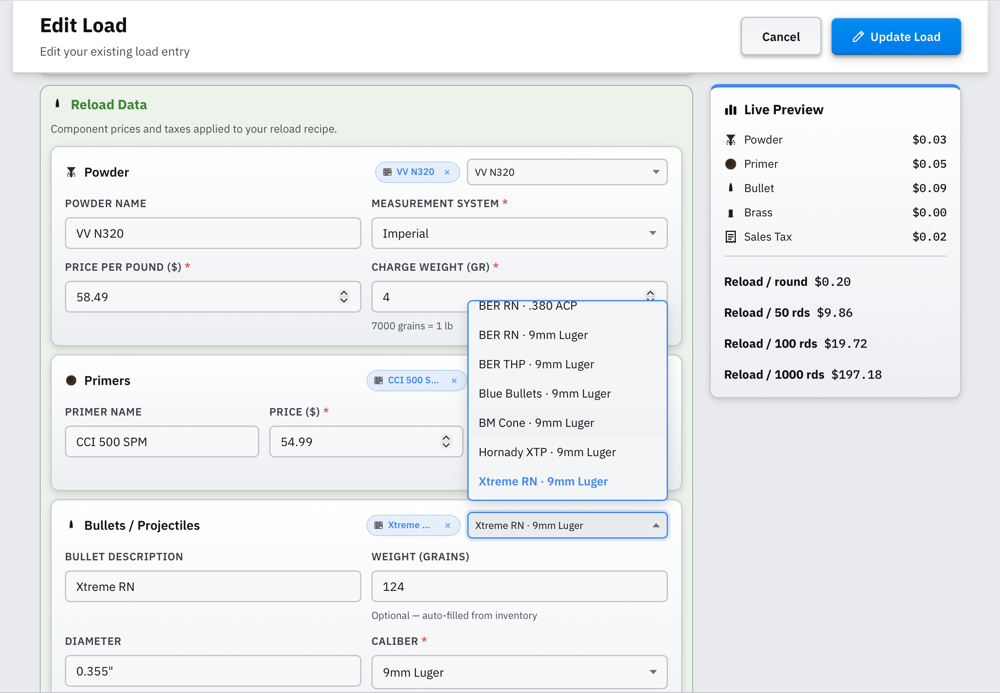

**What the linked badge means:**  
A small inventory icon next to the component name shows its values come from My Components. If you edit any field in that section, the link is removed and the load keeps its own copy of the values.

You can also click the **×** on the badge to unlink without editing anything.

**Auto-update behaviour:**  
When you change a component in My Components, such as a new powder price, every reload still linked to it recalculates right away.

> **Tracking cost changes across batches.** Each journal entry locks in its cost per round when you log it, using the prices at that moment (see [5.2](#52-managing-journal-entries)). Changing a price later doesn't change what past lots cost.
>
> You can still duplicate a load and link the copy to a different inventory item if you want two recipes side by side, for example to compare batches in Cost Analysis. You don't need to do it just to keep old costs accurate.

**Inventory badge in My Ammo:**  
In My Ammo's expanded card, components linked to My Components show a small inventory icon next to their name.

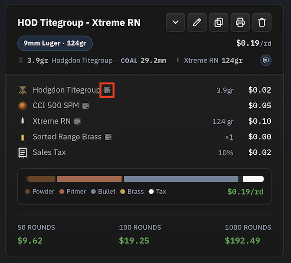

---

## 4. Firearms Registry

The **Firearms** tab is your catalog of the firearms you own and shoot. Every firearm here appears in the Range Log's firearm list, so your sessions stay tied to a known gun instead of a typed name. A profile holds the details that matter for load development (caliber, action, barrel length, and twist rate), plus a photo, serial number, price, and the mounted optic.

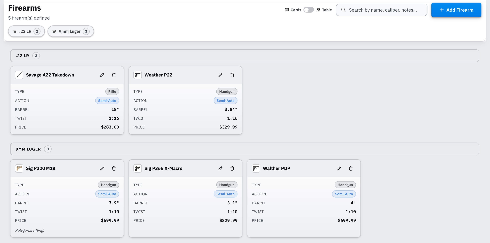

### 4.1 Adding a Firearm Profile

Click **Add Firearm** in the top-right corner. The dialog has a **Firearm** section and an optional **Optics** section.

**Firearm**

| Field | Required | Description |
|-------|----------|-------------|
| **Name** | Yes | A name for the firearm, e.g. *Remington 700 SPS*, *Glock 17 Gen 5*. |
| **Firearm Type** | No | Broad category: **Rifle**, **Handgun**, **Shotgun**, or **Other**. |
| **Action Type** | No | Operating mechanism: **Bolt**, **Semi-Auto**, **Lever**, **Pump**, **Single Shot**, **Revolver**, or **Other**. |
| **Caliber** | No | The cartridge it's chambered in, e.g. *.308 Win*, *9mm Luger*, *12 ga*. The list follows the Firearm Type. Used for grouping and the caliber filter chips. |
| **Barrel Length** | No | Free text, e.g. *24 in*, *16.5"*. |
| **Twist Rate** | No | e.g. *1:10*, *1:8*. Matters for bullet stability. |
| **Photo** | No | Upload a photo (iPhone HEIC photos are converted automatically). It's shown as a thumbnail wherever the firearm appears (see 4.4 and 4.5). Click **Remove** to clear it. |
| **Serial Number** | No | For your own records. |
| **Price** | No | What you paid for the firearm. |

**Optics** *(optional)*

Fields for the scope or sight mounted on the firearm:

| Field | Description |
|-------|-------------|
| **Manufacturer** | e.g. *Vortex*, *Leupold*. |
| **Model** | e.g. *Razor HD Gen III*. |
| **Type** | **Scope**, **Red Dot**, **Holographic**, **Prism**, **LPVO**, **Iron Sights**, or **Other**. |
| **Magnification** | Free text, e.g. *4.5-27x56*, *1x*. |
| **Focal Plane** | **FFP** or **SFP**. |
| **Reticle** | Free text, e.g. *EBR-7C MOA*, *TMR*. |
| **Turret Units** | **MOA** or **MRAD**. |
| **Zero Distance** | Free text, e.g. *100 yd*. |

Leave the Optics fields blank if there's no optic or you don't want to track it. The app then hides optics for that firearm.

**Notes**

Any other reference: known issues, purchase date, etc.

Click **Save**. The firearm shows up in the list and in the Range Log's firearm list right away.

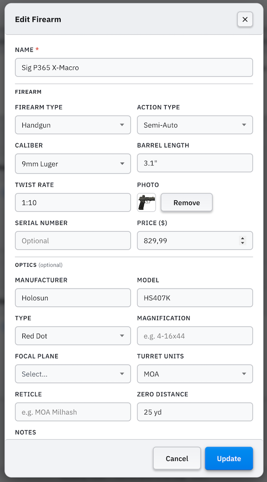

### 4.2 Managing Firearm Profiles

Each firearm profile (in both card and table view) has three action buttons:

| Button | Action |
|--------|--------|
| ✏️ Edit | Opens the profile for editing. If you rename the firearm, its past Range Log sessions follow the new name. |
| 📦 Archive | Retires the firearm without deleting it. Becomes **Restore** on an archived firearm. See below. |
| 🗑 Delete | Removes the profile for good. Past Range Log sessions keep the firearm's name. |

You're asked to confirm before deleting.

**Archiving firearms**

Sold a rifle or put one away for good? Archive it to keep its record without cluttering the list. You'll be asked to confirm. Archived firearms are hidden from the list, the Range Log's firearm list, and the **Dedicated Firearm** list on brass. Past range sessions keep their firearm, and brass already dedicated to it stays linked.

When anything is archived, the count under the page title ends with an **"N archived hidden"** link, and each caliber group shows **"N archived"**. Click either to show archived firearms, and click **hide archived** to hide them again. Archived cards are dimmed and tagged **ARCHIVED**; table rows get a red edge and an **Archived** tag. Click **Restore** to make one active again.

### 4.3 Filtering and Searching

**Caliber filter chips**

When at least one firearm has a caliber, **caliber filter chips** appear below the page header, each with a count. Click a chip to show that caliber; click it again to clear it. You can turn on several chips at once.

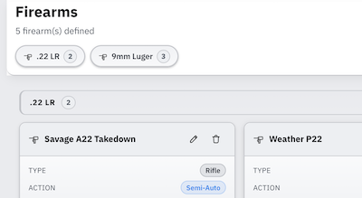

**Search**

The **Search** box filters by name, caliber, and notes. The count below the title shows how many match.

Search and chips work together: the list shows the firearms that match both.

### 4.4 Card and Table Views

The **Cards / Table** toggle switches the layout. The tab remembers your choice.

**Card view** (default): each firearm is a compact tile with its photo (or a firearm icon) and name in the header. The body shows only the fields you filled in: Type and Action badges, Barrel and Twist, then Serial, Optic, and Price. Long notes are shortened; hover over the note to read it all.

**Table view**: one row per firearm, with columns for Photo, Name, Type, Action, Barrel, Twist, Serial, Optic, and Price. Notes show as a short preview under the name; hover over it to read it all. This view is easier to scan when you have many firearms.

**Optic**: when a firearm has optic details, a scope icon appears in the Optic column (table) or Optic row (card). Hover over it to see the manufacturer, model, type, magnification, focal plane, reticle, turret units, and zero distance.

**Photo thumbnails**: hover over a firearm's thumbnail to see its full datasheet (see 4.5).

In both views, profiles are grouped by caliber. Firearms without a caliber appear in an **Uncategorized** group at the bottom.

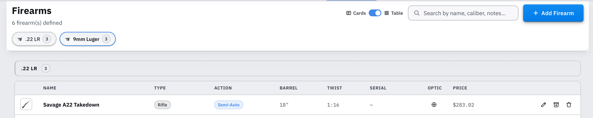

### 4.5 Firearm Datasheet

Hover over a firearm's photo thumbnail, in card or table view, to open its **datasheet**: the full photo, name, Type and Action badges, Barrel, Twist, Serial, and Price, the **Optics** section (if set), and Notes. It's read-only. Move the pointer away to close it.

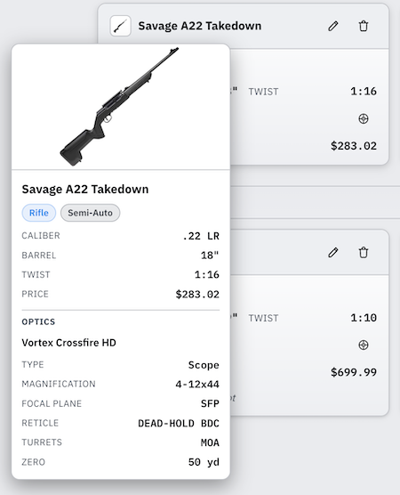

---

## 5. Reloading Journal

The **Journal** tab is the heart of the app. Each time you sit down at the press, add an entry with the load, the number of rounds, and the date. Each entry gets the next **lot number**, ready to print on a box label. Over time, the journal becomes a searchable history of every batch you've pressed.

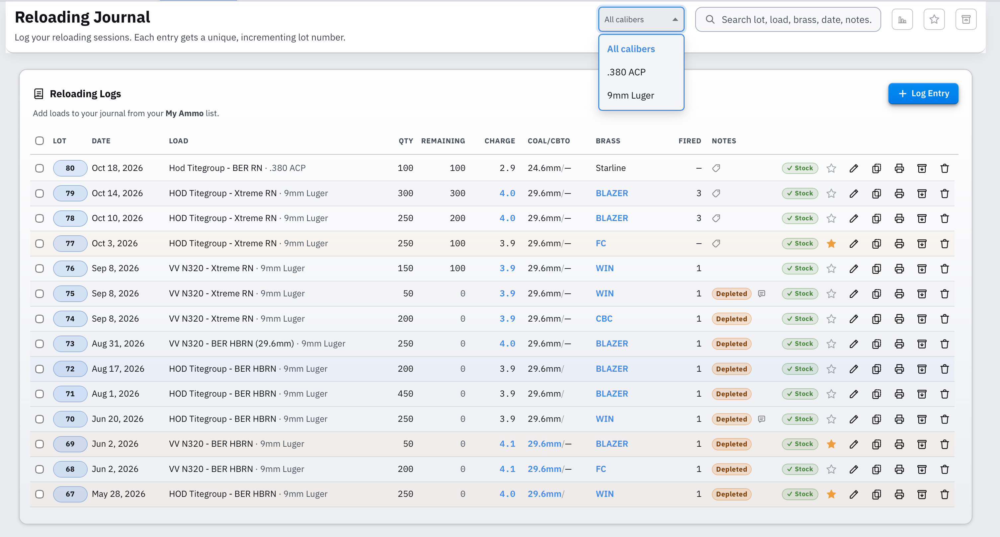

### 5.1 Logging a Session

Click **Log Entry** at the top right of the entries card. Fill in:

| Field | Description |
|-------|-------------|
| **Date** | The date of the session (defaults to today). Required. |
| **Load** | Select from your Active or In Development reload entries. Required. |
| **Qty** | Number of rounds produced. Required. |
| **Charge override** | Optional. Only if this batch used a different charge than the recipe. Overrides are highlighted in the journal row. |
| **COAL override** | Optional. Per-lot cartridge overall length if it differs from the recipe. |
| **Brass override** | Optional. The brass you used, if different from the recipe. |
| **Powder / Primer / Bullet / Brass lot** | Optional. The manufacturer lot codes of the components you used. New entries fill these in from the load's linked components in My Components (see [3.1](#31-adding-a-component)); change them if you used a different lot. Picking a different brass fills in its lot. |
| **Notes** | Optional, e.g. seating depth. |

The next lot number is shown at the top of the dialog and assigned when you save. Click **Save Entry**; the new entry appears at the top of the list.

For a shotshell load, COAL and CBTO are hidden, **Brass override** becomes **Hull override** (picked from your hulls), and the lot fields become powder, primer, shot (or slug), wad, and hull.

Component lots only fill in automatically for new entries. Older entries stay blank, since today's lots may not be the ones you used then; edit an entry to add them if you know them.

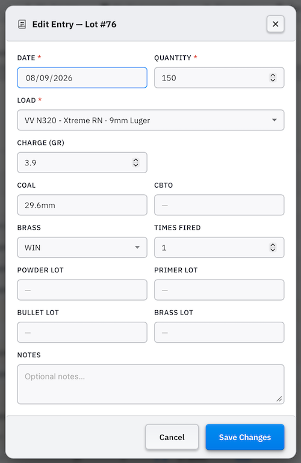

**Starting lot number**  
At the top of the summary panel (when expanded) you can set the **Starting lot #**. The next lot number is always the first unused number at or above it. To start a new series at 100, for example, set it to 100. Lot numbers never repeat: if a number is taken, the next free one is used. Use it to continue a numbering you kept elsewhere, or to start a new series for a new project or caliber.

### 5.2 Managing Journal Entries

Each entry row has action buttons on the right:

| Button | Action |
|--------|--------|
| ☆ Star | Marks the entry as a reference lot (starred entries show a coloured accent) |
| ✏️ Edit | Opens the entry for editing; the lot number is fixed and cannot be changed |
| ⧉ Duplicate | Copies the entry with the next lot number and the same component lots, handy for pressing another batch at the same settings |
| 🖨 Print | Opens the label print dialog pre-filled with the lot number and quantity |
| 📦 Archive | Moves the entry out of the main list. Nothing is lost, and you can restore it any time. |
| 🗑 Delete | Permanently removes the entry |
| 📦 Deduct from stock | Shown only when the load has a linked component with stock set. See below. |

**Deducting inventory stock from a journal entry**

When a reload is linked to components that have **Stock on hand** set, an inventory icon appears on the journal row. Click it to take the lot's usage out of stock:

| Component | Amount deducted |
|-----------|----------------|
| Powder | Weight used: `(rounds × charge in grains) ÷ 7000` lb, or `(rounds × charge in grams) ÷ 1000` kg for metric. A charge override is used if the entry has one. |
| Shot | Weight used: `(shells × payload in oz) ÷ 16` lb, or `(shells × payload in grams) ÷ 1000` kg for metric. |
| Primer, Wad | 1 per round (`quantity`) |
| Bullet, Slug | 1 per round (`quantity`) |
| Brass, Hull | 1 per round (`quantity`). If the entry has a **Brass** or **Hull override**, the item is matched by name. |

After deducting, the button becomes a **✓ Stock** badge. Click it to put the stock back, for example to fix a mistake.

If you **edit** an entry that already had stock deducted and change the round count, charge override, or brass override, the app puts back the old amount, deducts the new one, and re-locks the cost (see below).

Stock deduction is not available for archived entries.

**Cost is locked in when you log an entry**

Component prices change: last year's powder price isn't today's. So each lot's cost per round is **frozen when you log it**, using the prices at that moment. Changing a price in My Components afterward doesn't change what the lot cost. This happens for every entry, whether or not you use Deduct from Stock. The **Cost Summary** panel shows these locked-in costs, and hovering over a lot's **✓ Stock** badge shows its rate.

Changing only an entry's quantity keeps its rate. Changing its load, charge override, or brass override recalculates the rate at today's prices.

This only affects how past lots are *recorded*. **Cost Analysis** (section 8) always uses today's prices, because it answers "at current costs, how many rounds until my equipment pays for itself?", not "what did I spend?"

If you used the app before this feature, your existing entries are locked in the first time you open the Journal, at the prices current then. The app has no record of what you paid earlier.

**Component lots**
Entries with component lots show a tag icon in the Notes column. Hover over it to see the powder, primer, bullet, and brass lots used for that batch.

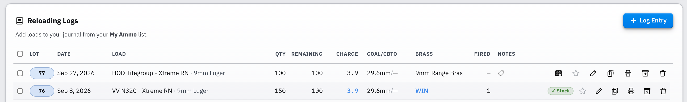

**Remaining Rounds column**
The **Remaining** column shows how many rounds of each lot haven't been fired. It comes from the Range Log: each time you log rounds from a lot, the count goes down. When every round is accounted for, the lot is marked **Depleted**. You always know what's left on the shelf without keeping a separate count.

**Archiving and restoring entries**
Click **📦 Archive** to move a lot out of the active list without deleting it. Archived entries stay in your history and still count in the Journal statistics, but their unfired rounds no longer count toward the load's stock in My Ammo. When any entries are archived, the page description ends with an **"N archived hidden"** link. Click it (or the archive filter button in the header) to show them, and click **hide archived** to hide them again. Archived rows are dimmed and tagged **Archived**. Click **Restore** on a row to make it active again.

Use the **Search** box to filter entries by lot number, date, load name, caliber, brass, notes, or component lot. For example, search a primer lot code to list every batch pressed with it.

When your journal holds more than one caliber, a **caliber filter** appears next to the search box. Pick a caliber to show only its lots, or **All calibers** to clear it. It works with search and the starred and archived filters, and **Select all** for batch printing only picks the entries shown.

**On phones and tablets**
On narrow screens, each entry stacks its lot, date, load, quantity, remaining rounds, and notes, with the action buttons alongside. Charge, COAL/CBTO, brass, and fired count are hidden; open the entry to see them.

### 5.3 Printing a Lot Label

Click **Print** on any journal entry. The label dialog opens with **LOT** and **QTY** filled in; check it and print.

You can review and change every field before printing:

- **Load name and caliber**, taken from the linked reload entry
- **LOT**, pre-filled with the entry's lot number
- **QTY**, pre-filled with the number of rounds logged
- All other label fields (powder, primer, bullet, brass, COAL, notes) are pulled from the load definition

You can also print from any card in **My Ammo** with its print button. LOT and QTY are then left blank.

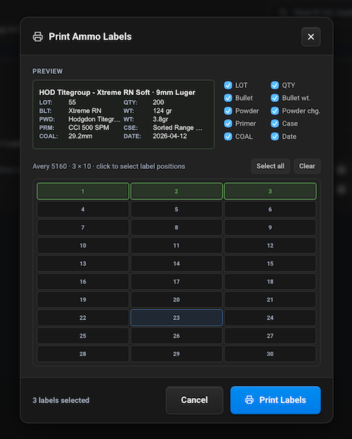

To print several labels at once, tick the checkbox at the start of each journal row you want, then click **Print N Labels** at the top of the list. The dialog shows all the selected labels, and you can print several copies of each.

### 5.4 Journal Statistics

The **summary panel** on the right of the Journal tab shows:

- **Rounds by Load**: total rounds produced for each reload, sorted by volume
- **Total cost per load**: rounds multiplied by the cost per round for that load
- **Grand total rounds** and **grand total cost** across all entries

These totals update as you add entries. Each lot is costed at its locked-in rate (see [5.2](#52-managing-journal-entries)).

---

## 6. Range Log

The **Range Log** is where you record what happens after the ammo leaves the bench. For each range trip, add a session: pick the firearm, enter the date and distance, then list each lot you fired with its round count and notes. Lots can come from the Reloading Journal, reload batches you enter by hand, or factory ammo. Over time it becomes a searchable record linking every range trip to the lots and recipes you shot.

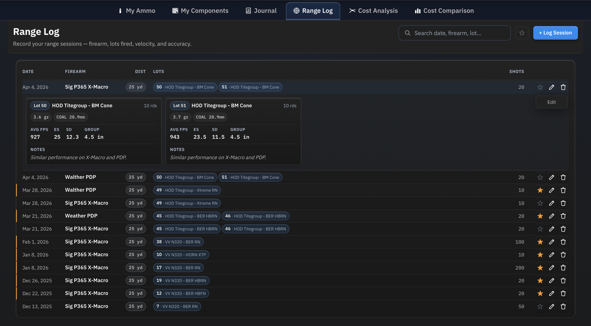

### 6.1 Logging a Range Session

Click **+ Log Session** at the top of the Range Log. Fill in:

| Field | Description |
|-------|-------------|
| **Date** | The date of the range trip (defaults to today). Required. |
| **Firearm** | Pick one from the **Firearms** tab (see [Section 4](#4-firearms-registry)), or type a new name. Required. A new name is added to the Firearms tab as a basic profile you can fill in later. |
| **Distance** | The distance at which you shot, with a unit selector (yd / m) |
| **Temperature / Wind** | Optional session conditions |
| **Notes** | Optional: conditions, impressions, or anything else |

Then add one or more **lots** under **Lots fired**. Each lot row has three modes:

| Mode | When to use |
|------|-------------|
| **From Journal** | Ammo you logged in the Reloading Journal. Pick the lot; charge and COAL fill in. Rounds start at the lot's unfired count, and you can't log more than that. Depleted lots aren't listed. |
| **Reload** | A reload batch you didn't log in the Journal. Enter an optional lot number, pick the recipe, and override charge or COAL if needed. |
| **Factory** | Factory ammo, picked from your factory entries. There are no charge or COAL fields. If the entry tracks [stock](#22-adding-a-factory-ammo-entry), the list shows the rounds available and you can't log more than that; empty entries aren't listed. Entries without stock tracking have no limit. |

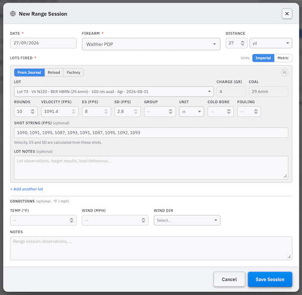

For every lot you can also record how it performed:

| Field | Description |
|-------|-------------|
| **Rounds** | Number of rounds fired from that lot |
| **Avg fps** | Average muzzle velocity |
| **ES** | Extreme spread (fps) |
| **SD** | Standard deviation (fps) |
| **Group** | Group size with unit (in / cm / MOA / MIL) |
| **Shots** | Number of shots in the group |
| **Cold bore** | Cold bore rounds fired |
| **Fouling** | Fouling shots fired before recording |
| **Shot string** | Optional. Each shot's velocity from your chronograph, separated by commas or spaces, e.g. *2810, 2815, 2798*. See below. |
| **Notes** | Per-lot observations |

**Entering a shot string**
Paste the shot string from your chronograph and the app works out **Avg fps**, **ES**, and **SD** for you. Those three fields are then locked so they always match the shots. SD is the sample standard deviation, the same figure chronographs report. Clear the shot string to type the numbers yourself. The shots are saved with the session and shown when you expand it.

Use the **⧉** button on a lot row to copy it when you fired several similar lots. At least one lot needs ammo selected before you can save.

Click **Save Session** when done.

**Unit system**
The **Imperial / Metric** toggle in the page header switches how velocity, group size, and distance are shown in the Range Log (including the form) and the Target Comparison table. Both places share the setting, and it's remembered. Only the display changes; your recorded numbers stay as entered.

### 6.2 Managing Range Sessions

Sessions are listed newest first. Click a row to **expand** it and see each lot.

**Best group marking**: for each firearm, the lot with the smallest group gets a small gold bullseye on its lot badge, in both the collapsed and expanded views. It moves automatically when you log a better group.

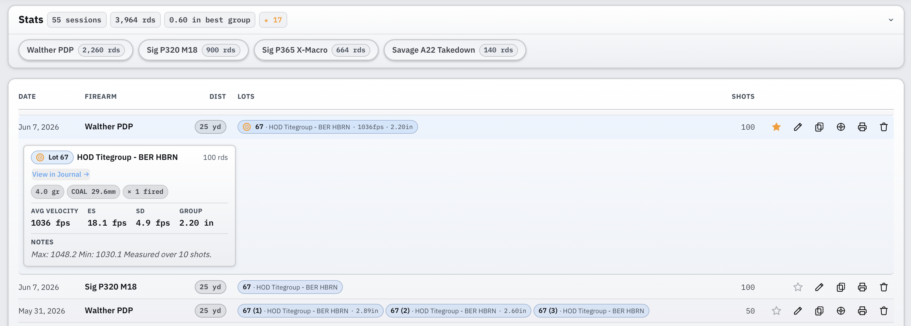

Each session row has action buttons on the right:

| Button | Action |
|--------|--------|
| ★ Star | Marks the session as a reference (see [Starring Sessions](#63-starring-sessions)) |
| ✏️ Edit | Opens the session for editing, including adding and removing lots |
| ⧉ Duplicate | Copies the session, handy for regular outings with the same firearm at the same place |
| 🎯 Target | Opens the linked target in the Targets tab. Shown only when a target is linked. |
| 🖨 Print | Prints the session's data sheet. A linked target adds its marked-up image and key statistics. |
| 🗑 Delete | Removes the session and all its lots for good |

Use the **Search** box at the top of the page to filter sessions by firearm, date, lot number, or load name.

### 6.3 Starring Sessions

Click the **star** (☆ / ★) on a session row to mark it as a reference. Starred sessions get a coloured left edge.

Starring a session also **stars the journal lots** it used in **From Journal** mode, so your best lots are flagged in the Journal too.

Click the **starred filter** (☆) in the page header to show only starred sessions, handy when you're choosing what to press again.

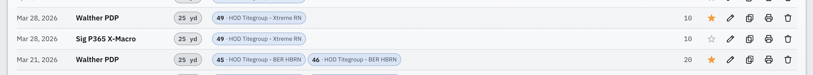

### 6.4 Range Log Statistics

The **statistics panel** at the top of the Range Log sums up all your sessions. Click the bar to expand it.

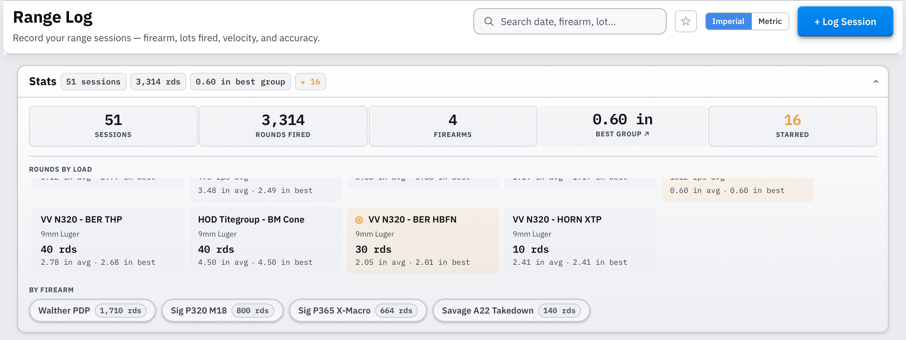

The panel has two sections:

**Key Performance Indicators**: a row of summary tiles across the top:

| Tile | Meaning |
|------|---------|
| **Sessions** | Number of range sessions logged |
| **Rounds Fired** | Total rounds fired across all sessions |
| **Firearms** | Number of distinct firearms used |
| **Best Group** | Smallest group recorded, in inches. Click it to jump to that session. |
| **Starred** | Number of starred sessions (shown once you have at least one) |

**Rounds by Load**: a scrollable row of cards, one per distinct load or factory entry. Each card shows:

- Load name and caliber, with total rounds fired
- Average fps and average SD (if velocity data was recorded for that load)
- Average group size and best group size (if group data was recorded for that load)

The load with the best (smallest) group **for its caliber** gets the same gold bullseye, so your standout recipe in each caliber is easy to spot. The cards also help during load development: you can see which recipes group best or hold the most consistent velocity.

---

## 7. Targets

The **Targets** tab has three sub-tabs:

- **Target Analysis**: upload a photo of your target, set the scale, mark the impacts, and get group statistics right away (extreme spread, mean radius, CEP50, windage and elevation offset, and more). If you shot several loads at the same aiming point, put the impacts in colour-coded groups to compare each load.
- **Compare**: a sortable table of every target linked to a range session. Filter by load to see its best ES, average MV, and best group. The open button on a row takes you to that target.
- **Target Generator**: design and print your own target sheets: scoring rings, colours, sizes, several targets per page, grid overlays, and load and firearm details for each target.

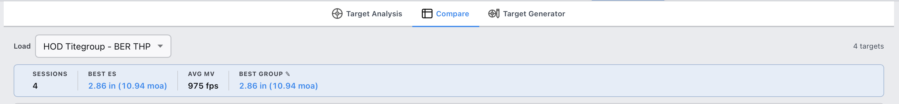

---

### 7.1 Target Analysis sub-tab

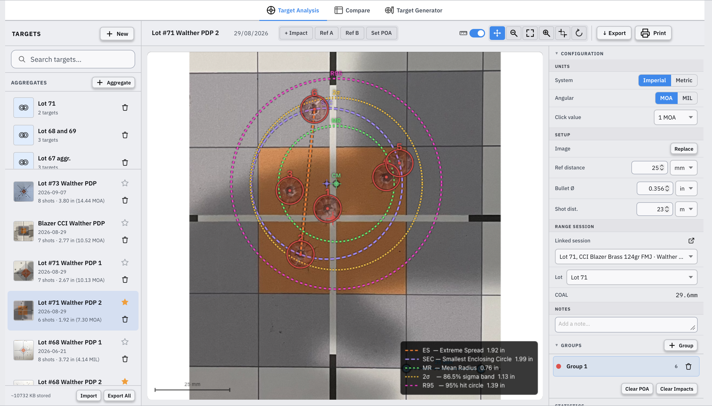

The Target Analysis sub-tab has three panels:
- **Left**: your saved targets, each with a thumbnail, name, date, shot count, and best group.
- **Centre**: the canvas where you upload the image and place or review impacts.
- **Right**: the Configuration panel (calibration, bullet size, distance, notes, and range session link) and the Statistics panel.

> **Unsaved changes.** If you try to leave with unsaved impacts or settings, you're asked to confirm. Click **Discard & Leave** to go without saving, or cancel to stay.

#### 7.1.1 Creating a Target Record

Click **+ New** at the top left. A blank record opens, using your Imperial or Metric setting. Give it a name and date in the toolbar above the canvas.

Each target in the list shows:
- A thumbnail of the photo (or a placeholder if there isn't one yet)
- The target name and date
- Shot count and best group size

Click **☆ / ★** on a target to mark it as a reference. Click 🗑 **Delete** to delete it (you'll be asked to confirm).

#### 7.1.2 Uploading and Calibrating the Image

**Uploading**

Click the upload area in the centre (or drag an image onto it) to load your target photo. JPEG and PNG are supported. The image is stored with the rest of your data and included in exports.

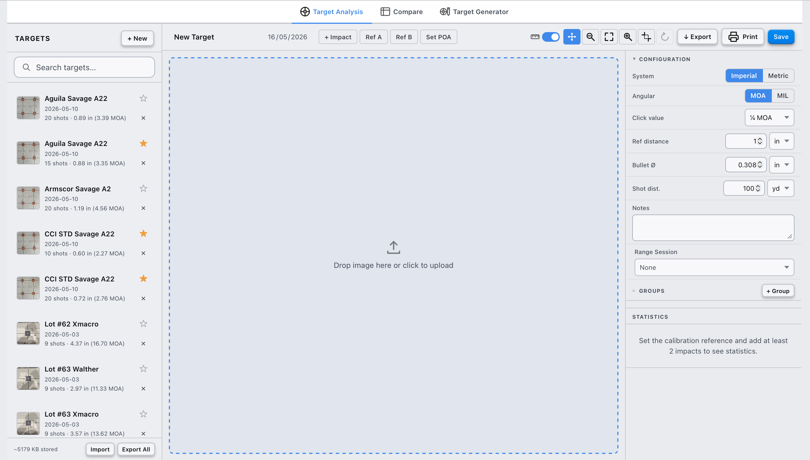

**Calibrating**

Before placing shots, set the scale so the statistics are in real units:

1. Select **Calibrate** from the mode buttons in the toolbar.
2. Click the first reference point (e.g. one edge of a known dimension on the target).
3. Click the second reference point (e.g. the opposite edge).
4. In the **Configuration** sidebar, enter the real-world distance between those two points and choose the unit (in / cm / mm).

The app divides the distance in pixels by the real distance to get the scale. All statistics update whenever the calibration changes.

> **Tip:** Use a printed grid square, a ring of known diameter, or any other feature you can measure. Note the measurement before the session so it's ready when you upload the photo.

**Configuration panel fields**

The panel has four headings: **Units** (measurement system, angular unit, click value), **Setup** (image, calibration, bullet diameter, shot distance), **Range session** (linked session, its lot, and CBTO/COAL), and **Notes**.

| Field | Description |
|-------|-------------|
| **Calibration reference** | The two reference points and their real-world distance |
| **Bullet diameter** | Diameter of the bullet, in inches or mm. Used to measure ES and group size from the outer edges of the holes instead of their centres |
| **Shot distance** | The distance the target was shot at. Used to show MOA / MIL values |
| **Measurement system** | Imperial (inches) or Metric (centimetres) for linear statistics |
| **Angular unit** | MOA or MIL for angular statistics |
| **Click value** | Your scope's adjustment per click, in the angular unit. Used to work out how many clicks move your point of impact onto your point of aim |
| **Notes** | Optional free-text notes for this target |
| **Linked session** | Optional link to a range session (see [Section 7.1.7](#717-linking-to-a-range-session)) |
| **CBTO / COAL** | Read-only. Shown once the target is linked to a reload lot: the lot's CBTO, or COAL if there's no CBTO. Not shown for factory ammo. |

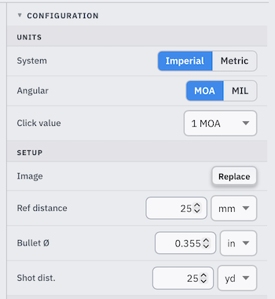

#### 7.1.3 Marking Impacts and Point of Aim

**Placing shots**

Choose **Add Impact** in the toolbar, then click each bullet hole. Each click places a numbered marker, in the order you place them.

To remove an impact, switch to **Edit** mode, click the marker, and delete it. You can also use the per-impact controls in the Statistics panel.

**Setting the point of aim**

Choose **Set POA**, then click the point you aimed at (usually the centre of the bullseye). Windage, elevation, and POI distance are measured from this point.

If no point of aim is set, the group centre is used instead, so offsets show each shot's distance from the group centre.

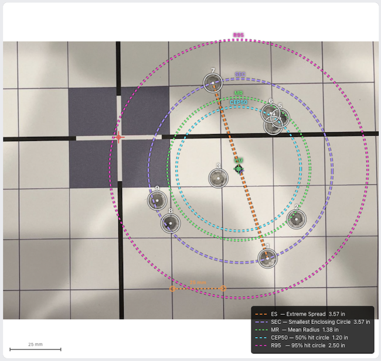

**Toolbar modes**

| Mode button | Function |
|-------------|----------|
| **Add Impact** | Click on the canvas to place a new numbered impact |
| **Set POA** | Click to place or move the point of aim marker |
| **Calibrate** | Click two reference points to set the calibration baseline |
| **Pan / Zoom** | Drag to pan the canvas; use the zoom buttons or scroll wheel to zoom in and out |

The toolbar also has **Zoom In**, **Zoom Out**, and **Fit**, and a **Print** button (see [Section 7.1.8](#718-printing-a-target)). Buttons are grouped: modes on one band, view tools (pan, zoom, crop, rotate) on another, and Export, Print, and Save on the right.

#### 7.1.4 Statistics Panel

The **Statistics** panel in the right sidebar shows metrics for the current view: all shots, one group, or the aggregate. You can collapse it.

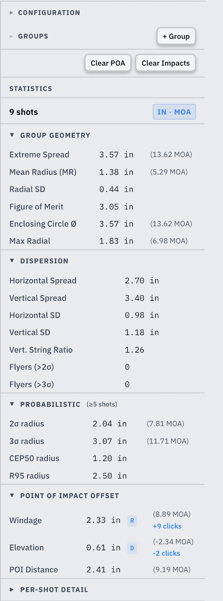

#### Group geometry

These describe the size and shape of the group.

| Statistic | What it measures |
|-----------|-----------------|
| **Shots** | Number of impacts counted in this view |
| **Extreme Spread (ES)** | The distance between the two farthest-apart holes, centre to centre (or edge to edge when bullet diameter is set). The most common group-size measure. It's a **diameter**. Smaller is better. |
| **Smallest Enclosing Circle Ø (SEC)** | The diameter of the smallest circle around all the holes. ES depends only on the two worst shots; SEC reflects the whole group. It's always ≥ ES. |
| **Mean Radius (MR)** | The average distance from each shot to the group centre. Because it uses every shot, a single flyer affects it less than ES. It's a **radius** from the group centre. |
| **Figure of Merit (FoM)** | The average of the horizontal and vertical spreads. A quick check of whether the group is roughly round. |
| **Horizontal Spread / Vertical Spread** | The width and height of the group. A group much taller than it is wide points to vertical stringing. |
| **Horizontal SD / Vertical SD** | Standard deviation on each axis. A low vertical SD with a high vertical spread means the outlying shots sit at the extremes, a classic sign of inconsistent muzzle velocity. |
| **Radial SD** | Standard deviation of each shot's distance from the group centre. A useful summary of how tightly the shots cluster, and the basis for the Rayleigh σ below. |
| **Max Radial Deviation** | Distance from the group centre to the farthest shot. |
| **Vertical String Ratio** | Vertical spread divided by horizontal spread. Above 1.5 it's highlighted as a stringing warning: the group is much taller than wide, often from inconsistent velocity, trigger timing, or recoil control. |

#### Probabilistic statistics

These use a statistical model to estimate where future shots will land if you keep firing this load. They need at least 5 shots, because smaller samples aren't reliable.

The model is the **Rayleigh distribution**. It fits a 2D impact pattern when horizontal and vertical errors are independent and similar in size, which is reasonable for a well-centred, accurate load. All values here are **radii** from the group centre, not diameters.

> **Radius vs diameter.** ES is a diameter (the full spread between two holes). CEP50, R95, and the sigma radii are radii (distance from the centre). So if R95 = 2.5 in, its circle is 5 in across, which should be larger than ES for a well-modelled group.

The scale parameter **σ** is estimated from your shots with σ = √(Σrᵢ² / 2n), where rᵢ is each shot's distance from the centre and n is the number of shots. Every value below comes from this σ.

| Statistic | What it means |
|-----------|--------------|
| **CEP50** | Circular Error Probable at 50 %: the radius around the group centre that should hold *half* of your future shots. Think of it as the median accuracy radius. Smaller is better. Value = σ × 1.177. |
| **R95** | The radius that should hold 95 % of future shots: everything but rare outliers. Value = σ × 2.448. |
| **2σ radius** | The circle that should hold about 86.5 % of future shots. Shots outside it count as **Flyers (>2σ)**. Value = σ × 2. |
| **3σ radius** | The circle that should hold about 98.9 % of future shots. Shots outside it count as **Flyers (>3σ)** and should be rare with a consistent load. Value = σ × 3. |
| **Flyers (>2σ)** | Shots farther from the centre than the 2σ radius (the model expects about 13.5 %). One or two in a 10-shot group is normal; more than two or three suggests an inconsistent load, or that the model doesn't fit well. |

#### Point of impact offset

Where the group centre landed compared with your point of aim. Without a POA, the group centre is used and all offsets are zero.

| Statistic | What it means |
|-----------|--------------|
| **Windage offset** | How far left or right the group centre is from the point of aim, with direction label. |
| **Elevation offset** | How far up or down the group centre is from the point of aim, with direction label. |
| **POI distance** | The straight-line distance from the point of aim to the group centre, combining windage and elevation. |
| **Clicks needed** | The scope clicks needed to move the point of impact onto the point of aim, based on your click value. Positive = right/up; negative = left/down. Shown only when a click value is set. |

Linear values use the unit set in the Configuration panel (in or cm). With a shot distance set, MOA or MIL values appear in brackets next to them.

#### 7.1.5 Working with Groups

Groups let you sort the shots on one target by load, charge, or anything else. Each group has its own colour and statistics.

**Creating a group**

Click **+ Group** in the **Groups** section of the sidebar. The new group gets a default name and its own colour. Click the name to rename it.

Click a group to select it. The canvas highlights its shots and the Statistics panel shows its numbers.

**Assigning shots to a group**

New impacts go into the selected group. To move a shot, switch to **Edit** mode, click it, and pick a group from the selector that appears.

**Group colours**

Each group gets its own colour. Its markers, overlays (ES line, mean radius circle), and list row all use that colour, so you can tell the loads apart at a glance.

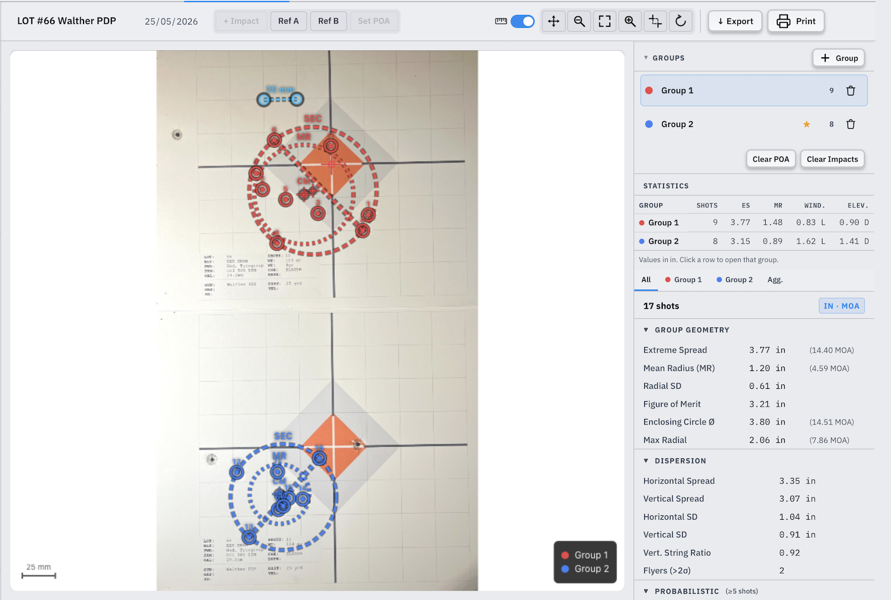

#### 7.1.6 Aggregate View

When a target has **two or more groups**, view tabs appear above the Statistics panel:

| Tab | Description |
|-----|-------------|
| **All** | Shows every impact in place; statistics treat them as one group |
| **Group name** (one per group) | Shows only that group's impacts; statistics are computed for that group alone |
| **Aggregate** | Moves each group so their centres line up, then stacks them. Statistics show the typical spread of one group, averaged across all groups |

**Aggregate** is handy when you've fired several loads at the same aiming point: it removes the offset between loads and shows only how tight each one is.

**Group comparison table**
Above the tabs, a small table lists every group side by side: shots, extreme spread, mean radius, and windage and elevation offset. It's the quickest way to compare several charges on the same target. Click a row to open that group. A group needs at least two shots to appear.

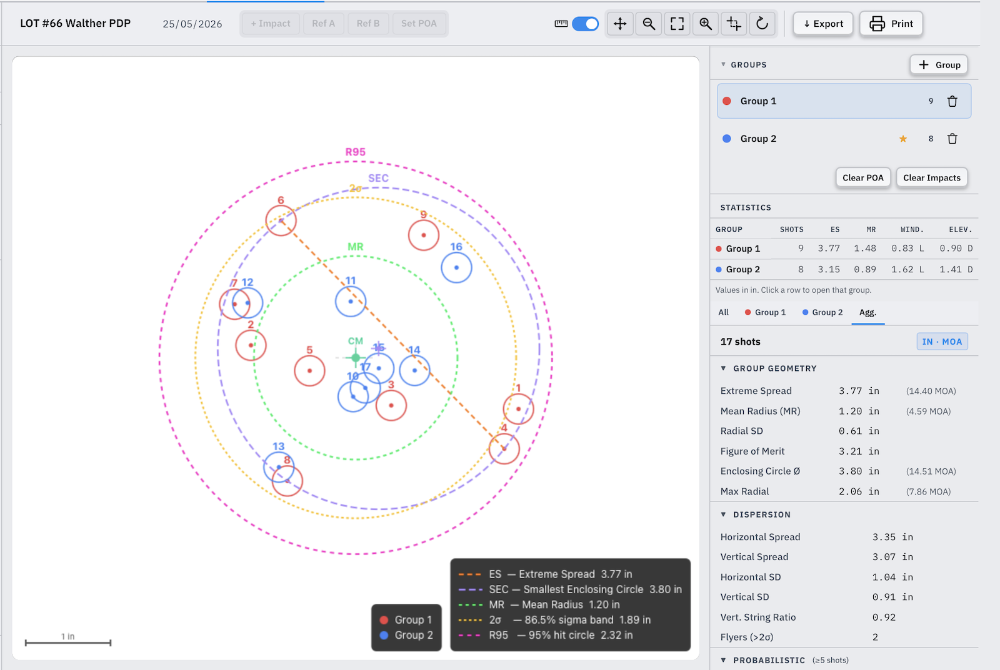

#### 7.1.7 Linking to a Range Session

In the **Configuration** sidebar, the **Linked session** field (under **Range session**) links this target to a range session. Click it to search your sessions by date, firearm, distance, or lot number.

Once linked:
- An arrow button next to the session takes you to it in the Range Log.
- The linked lot's **CBTO** (or **COAL** when no CBTO is recorded) appears below the session, and on the printed target.
- In the Range Log, the linked session gets a **target icon**. Click it to come back here.
- **Printing** the linked range session adds this target's image and key statistics automatically (see [Section 7.1.8](#718-printing-a-target) and [Section 6.2](#62-managing-range-sessions)).

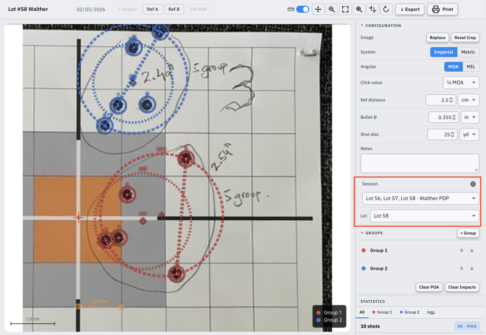

#### 7.1.8 Printing a Target

Click **Print** in the target toolbar to print the current view.

The printed sheet includes:
- The marked-up target: impact circles, shot numbers, a dashed **ES line** between the two farthest shots, a solid **mean radius circle**, and a dashed **CEP50 circle** (with 5 or more shots)
- The target name and view label (group name or "All Groups")
- Key statistics: shot count, extreme spread, mean radius, POI offset, and CEP50
- The linked lot's CBTO (or COAL), when the target is linked to a reload lot

With several groups, the active view (All, one group, or Aggregate) is what gets printed.

> Printing a **range session** from the Range Log includes the linked target's image and statistics at the bottom of the sheet; see [Section 6.2](#62-managing-range-sessions).

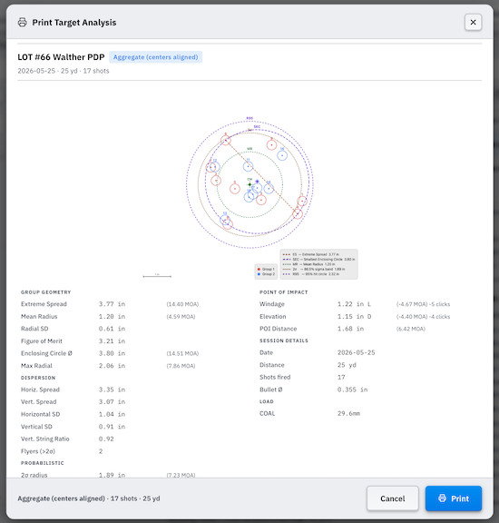

#### 7.1.9 Aggregating Groups Across Targets

The **Aggregate View** (Section 7.1.6) combines groups on one target. To combine groups from *different* targets, for example several loads each shot on its own target, create an **Aggregate**: a saved record listed with your targets.

**Creating an aggregate**
Click **+ Aggregate** above the target list, name it, and pick two or more targets that each have at least one group. Aggregates are listed in their own section above your targets.

**Viewing an aggregate**
An aggregate opens read-only. Every included group is placed on a blank canvas, each centred on itself (like the single-target Aggregate view) and coloured by group, with combined statistics and a scale ruler. Photos aren't shown, only the shots.

You can change two things here:
- **Included Groups**: a checklist of every group in the aggregated targets. Untick a group to leave it out; at least one must stay. Your choice is saved.
- **Imperial / Metric**: the same toggle as elsewhere, also saved.

You can also rename or delete the aggregate (🗑 on its list row). The targets themselves are never changed.

The group comparison table (see [7.1.6](#716-aggregate-view)) appears here too, with each group's shots, extreme spread, and mean radius. Windage and elevation are left out, since the groups are re-centred.

**Stays in sync automatically**
An aggregate doesn't copy data; it reads its targets live. If you add an impact, move a shot, or change a group on any of them, the aggregate shows it the next time you open it. If a target is deleted, the aggregate drops its groups and keeps the rest.

**Printing**
Click **Print** in the aggregate's toolbar. The printout matches a regular target, with a header listing the source targets.

---

### 7.2 Compare sub-tab

The **Compare** sub-tab puts every target linked to a Range Log session in one sortable table. Target Analysis is for studying one target; Compare answers the bigger question: *which load, charge, and seating depth gave the best groups and the most consistent velocity?*

**Unit system**
The **Imperial / Metric** toggle next to the Load filter is shared with the Range Log (see [Section 6.1](#61-logging-a-range-session)); changing it in one place changes both. It sets how velocity, distance, group size, and mean radius are shown here. Every row is converted, whatever unit it was recorded in, so rows are always comparable.

#### How rows are populated

Each target linked to a Range Log session (see [Section 7.1.7](#717-linking-to-a-range-session)) gets a row. Link a target to include it.

#### Columns

| Column | Source |
|--------|--------|
| **Date** | Date of the linked range session |
| **Target** | Target name, with the firearm below. An amber ★ means the session is starred |
| **Load** | Load name from the linked session lot |
| **Charge** | Charge weight from the lot (blank for factory ammo) |
| **CBTO / COAL** | From the lot (CBTO when available) |
| **Dist.** | Shooting distance from the range session, converted to the selected unit system |
| **Shots** | Number of shots recorded in the linked lot |
| **MV** | Average muzzle velocity from the range session lot, in the selected unit system (fps or m/s) |
| **SD** | Standard deviation of velocity from the range session lot, in the selected unit system |
| **Group** | Extreme spread computed from the target image in Target Analysis, converted to the selected unit system |
| **Mean R.** | Mean radius computed from the target image, converted to the selected unit system |

Click a sortable column header to sort by it; click again to reverse.

#### Filtering by load

Use the **Load** filter at the top to show one load. A **summary bar** then shows:

| Stat | Description |
|------|-------------|
| **Sessions** | Number of targets linked to this load |
| **Avg MV** | Mean of average muzzle velocities across all sessions for this load |
| **Best Group** | Lowest extreme spread (computed from the target image) across all sessions for this load |

#### Best row indicator

For each load, the row with the smallest Group gets a small gold bullseye in the Group column (as in the Range Log), and the row is lightly highlighted.

#### Opening a target from the table

Click the **open icon** (↗) at the end of a row to jump to that target in Target Analysis.

---

### 7.3 Target Generator sub-tab

The **Target Generator** lets you design your own printable target sheets. Set the scoring rings, layout, and annotations, then print. Sheets are saved, so you can reprint or duplicate them any time.

Click **New Target Sheet** to open the designer. It has two panels:
- **Left**: the settings for the sheet
- **Right**: a live print preview

#### 7.3.1 Creating a Target Sheet

Click **New Target Sheet** in the page header to open the designer with a blank sheet.

| Field | Description |
|-------|-------------|
| **Name** | A name for the sheet, e.g. *100 yd Load Workup* or *50 yd Pistol*. Shown on the sheet card. |
| **Page Size** | Letter, A4, or Legal. |
| **Orientation** | Portrait or Landscape. |
| **Columns × Rows** | Number of targets across and down the page (1–4 each). A 2 × 3 layout prints 6 targets per page. |
| **Shape** | Target shape: Circle, Square, or Diamond. |
| **Annotation: Load / Gun** | Two toggles: **Load** prints the load details (lot, components, shots) and **Gun** prints the firearm, distance, and result fields. Turn off both to print a bare target. |
| **Annotation position** | Inside the rings, or below the target. |

Click **Save Sheet** to save or **Cancel** to discard. The **Print** button in the designer header opens the print dialog.

#### 7.3.2 Configuring Rings

Each target has concentric scoring rings. Ring 1 is the centre; higher numbers are further out. A target has between **2** and **10** rings.

For each ring, configure:

| Option | Description |
|--------|-------------|
| **Color** | Black, white, red, orange, yellow, green, blue, grey, or silver. Mix colours for high-contrast scoring zones. |
| **Ring lines** | Turn on to draw a thin line (0.5 mm) between rings, in a colour you pick from the same palette. It separates rings of the same colour and makes scoring edges easier to read. The target's outer edge has no line. |
| **Overall diameter** | The outer diameter of the outermost ring (in inches or mm). |
| **Ring step** | The gap between ring edges, which sets how wide each scoring band is. |

The **in / mm** dropdown switches units; all diameters convert automatically.

The preview on the right updates as you go.

#### 7.3.3 Layout, Page Size, and Grid

**Layout**

Columns and rows set how many targets fit on a page. Use a dense layout (e.g. 3 × 4 = 12 targets) for small pistol targets or load-development series, or 1 × 1 for a single large rifle target.

**Grid overlay**

Turn on **Show Grid** to print a grid over each target, a handy reference for judging point of impact. Set the **grid cell size** in the same unit as the ring diameters. The **crosshair** (centre lines) has its own toggle.

#### 7.3.4 Annotations

When **Load** or **Gun** is on, each target on the sheet gets its own annotation block. A 2 × 3 sheet has six, labelled *Target 1*, *Target 2*, and so on. Fill them in before printing so the details are already on the sheet.

Each annotation has a **mode toggle**:

| Mode | Fields |
|------|--------|
| **Handload** | **Journal Lot** (searchable dropdown from your journal entries, newest first), Firearm, Shots, Distance, Notes |
| **Factory** | Cartridge name, Lot #, Firearm, Shots, Distance, Notes |

Firearm and Shots share a row, right above Distance and Unit.

Group size, average velocity, and SD are **not** entered here, since you won't know them before shooting. They print as blank labelled fields (e.g. *GRP:*, *VEL:*, *SD:*) for you to fill in at the range.

The **Load** and **Gun** toggles control which part of the block prints, so you can print the gun and result fields without the load details, or the other way round. Text that's too long, like a long firearm name, is shortened with an ellipsis.

**Filling multiple targets quickly**

- **Apply to all**: on the first target. Copies Target 1's annotation to every other target, for sheets where all targets share the load and firearm.
- **Copy prev**: on every other target. Copies the target before it, handy for load-development series that differ in one field.

#### 7.3.5 Managing Target Sheets

Saved sheets appear as cards. Each card shows:
- **Ring colour swatches** showing the colour scheme
- Sheet name, page size, columns × rows layout, and shape
- Last updated date

Each card has three action buttons:

| Button | Action |
|--------|--------|
| ⧉ Duplicate | Copies the sheet with all its settings, handy for a variant with different ring sizes or colours. |
| 🖨 Print | Opens the print dialog without opening the designer. |
| 🗑 Delete | Removes the sheet for good (you'll be asked to confirm). |

Click the card to reopen the sheet in the designer.

#### 7.3.6 Printing a Target Sheet

Click **Print** on a sheet card, or in the designer, to open the print dialog.

The dialog shows:
- Sheet name, page size, layout (columns × rows), and shape
- A preview of the first target as it will appear on the printed page

Click **Print** to send it to your printer. The printout matches the designer preview exactly.

---

## 8. Cost Analysis (Break-Even)

**Cost Analysis** compares the running cost of reloading, including your equipment, with buying factory ammo, and shows when reloading becomes cheaper overall.

### 8.1 Load Selection

The left column lists your reload and factory entries.

By default, both use **checkboxes**. Check the entries to include in the averages; if none are checked, **all entries of that type are included**. Your selection and round counts are saved.

Each entry fits on one line: checkbox, name, and cost per round. In **Rounds** mode a reload shows its name, round count, and journal rounds on the first line, with the cost per round and total rounds below, aligned right. A small thumbnail appears next to the name: the photo of factory ammo, or the photo of a reload's linked bullet (see [3.3](#33-linking-inventory-to-loads)).

Click a load's name to open its details: caliber, COAL/CBTO, and for reloads the powder, bullet, primer, and brass, each with its photo from My Components when it has one (the type icon otherwise). Factory ammo shows its photo. This is the same dialog you get by clicking a load name in the Journal.

For reloads, you can switch to **Rounds** mode with the switch at the top of the panel. In this mode:

- Reloads take a round count instead of a checkbox.
- The reload cost becomes a **weighted average** based on those round counts.
- Factory ammo still uses checkboxes.

**Journal integration in Rounds mode**

Rounds you log in the **Journal** are added here automatically. The number next to each reload's input is its *effective total*: what you entered (your pre-journal baseline) plus your journal rounds.

This helps if you were reloading before you started the journal: enter your earlier round count as a baseline, and the journal adds to it. Starting fresh? Leave it at zero.

### 8.2 Equipment Costs

The right column holds your one-time equipment costs (press, dies, tumbler, scale, and so on).

- Type a name and price in the **New item** row and press **Enter** or click **+** to add it.
- Click **✕** to remove an item.
- The running **Total Equipment Cost** is shown at the bottom.

This total is an upfront cost that your per-round savings must pay back before reloading comes out ahead.

Turn off the **Include** switch to leave it out.

### 8.3 Reading the Chart & Stats

The **stats bar** in the middle column shows the main values behind the break-even calculation:

| Stat | Meaning |
|------|---------|
| **Avg Reload Cost** | Average cost per round across selected reload entries |
| **Avg Factory Cost** | Average cost per round across selected factory entries |
| **Savings per Round** | Factory average minus reload average |
| **Break-Even Point** | Number of rounds until cumulative savings cover total equipment cost |

In **Rounds** mode, more progress values appear:

| Stat | Meaning |
|------|---------|
| **Reload Rounds Logged** | Total effective rounds (manual baseline + journal) across all reload recipes |
| **Rounds Remaining** | How many more reload rounds are needed to reach break-even |
| **Total Savings So Far** | Savings so far from your reload rounds, minus equipment when **Include** is on |

The **chart** below plots two lines:
- **Reload line**: total spend, starting at your equipment cost and rising more slowly than factory because each round is cheaper.
- **Factory line**: total spend at factory prices, starting at zero.

Where the lines cross is the **break-even point**, marked on the chart. After that, every round you reload saves you money.

In **Rounds** mode, the chart also marks your **current position**, based on your total reload rounds, so you can see how close you are.

If reloading costs more per round than factory, the lines never cross and a warning appears.

---

## 9. Cost Comparison

**Cost Comparison** lets you pick any mix of reload and factory entries and compare their costs side by side.

**Selecting entries**  
Click an entry to select or clear it. Selected reloads are green and factory ammo amber. You can select as many as you like.

**Reading the comparison**  
With entries selected, you'll see:

- A **bar chart** of cost per round for every selected entry.
- A **cost table** with totals for 50, 100, and 1,000 rounds for each entry.
- A **Difference** section (with at least one reload and one factory entry selected) showing how much cheaper your reload is per round and per 50, 100, and 1,000 rounds.

Use the **Search** box above the selection list to filter by name, caliber, type, or component.

---

## 10. Guided Tour

Click **Tour** in the top navigation bar to start the built-in walkthrough at any time.

The tour highlights the main parts of the app and shows:

- how to add and manage ammo entries
- how to use the inventory and linked components
- how to build and manage firearm profiles in the Firearms Registry
- how to log pressing sessions in the Journal and assign lot numbers
- how to record range sessions in the Range Log and track lot performance in the field
- how to compare reloads and factory ammo
- how to use the break-even analysis
- how to switch between simple selection and reload round-count analysis
- which values to check in the analysis stats cards

You can close the tour at any time. It's meant to help new users find their way.

---

## 11. Settings & About

The top right of the header has an **About** button and a **Settings** button.

**Settings**
- **Follow System Theme**: matches your device's light or dark mode, and switches as soon as the device does
- **Currency Symbol**: changes the currency shown across cards, tables, and analysis views
- **Cost Per Round Decimals**: controls how many decimal places are shown for per-round costs

The app starts in the **dark theme**. With **Follow System Theme** on, it follows your operating system. The theme toggle in the header switches back to manual light/dark mode.

---

## 12. Import & Export

Your whole library can be saved to a file and restored later, or moved to another computer. That includes ammo entries, tax defaults, equipment costs, load selections, components, journal, range log, firearms, and targets, with all photos.

**Exporting**
Click **Export** in the top bar. A `.zip` file with all your data and photos is downloaded.

**Importing**
Click **Import** and choose an exported `.zip` file (or a `.json` file from an older version). A dialog tells you whether a backup will be made first (see Auto-backup below). Confirm to continue. The file's data replaces your current library.

> **WARNING: Import overwrites your current data.** Export first if you want to keep your existing entries, or enable Auto-backup in Settings so a backup is downloaded automatically before every import.

**Auto-backup**
In **Settings**, **Auto-backup on import** downloads a backup `.zip` of your current data before an import replaces it. It's on by default. If you turn it off, imports can't be undone.

**Backward compatibility**
Exports from earlier versions (`.json` files) still import. They don't include target photos, which that format didn't support; everything else is restored.

---

## 13. Tips & Notes

- **Your data lives on your device.** Nothing is stored online, so **Export** regularly to keep a backup.
- **Prices drive every cost.** Results are only as good as the prices you enter. Update them when you buy a new batch.
- **Set a realistic brass reuse count.** Most cases last 5 to 10 reloads. A count of 1 treats every case as single-use and inflates your cost per round.
- **Define shared components once.** If several loads use the same powder or primer, add it to My Components and link it. One price update reaches every load.
- **Keep component lot numbers current.** Update a component's **Lot #** when you open a new jug or box. If SD or point of impact suddenly changes, you can trace it to a lot change.
- **Reload stock comes from the Journal.** Rounds count only if they're in a Journal lot and logged with **From Journal** in the Range Log. Log older ammo as a Journal entry so it counts.
- **Factory stock is a lifetime total.** Add boxes as you buy them; don't type your current count. To fix a mistake, add a negative number of boxes.
- **Brass overrides match by name.** Stock deduction looks for a brass item with exactly the override's name. If the names differ, the brass isn't deducted.
- **Use From Journal for workup lots.** Range results only reach the Charge Workup chart when you log the lot with **From Journal**, not **Reload**.
- **Already reloading before the Journal?** Enter your earlier round count as the baseline in Cost Analysis **Rounds** mode. The Journal adds to it from there.
- **Star your best range sessions.** The starred filter gives you a shortlist of proven loads, and their Journal lots are starred too.
- **Enter the bullet diameter on targets.** ES is then measured edge to edge, the way you'd measure with calipers.
- **Archive instead of deleting.** Lots, components, and firearms you no longer use can be archived. They keep their history and can be restored any time.
